<!-- upstream: https://github.com/cursor/plugins/blob/main/pstack/README.md -->
# mstack

mstack은 claude code와 codex에서 쓰는 엄격한 에이전트 워크플로 모음입니다. [mineru](https://github.com/Mineru98)의 작업 방식인 "코드는 적게, 품질은 높게"를 바탕으로 만들었습니다.

요즘 AI가 슬롭(slop) 코드, 곧 대충 찍어낸 저품질 코드를 너무 많이 쓴다는 말이 늘었습니다. 저도 동의합니다. 슬롭 장인 스무 명이 있는 팀처럼 배포하고 싶지는 않습니다. 품질 없는 처리량은 제가 바라는 목표가 아닙니다. 빨리 가고 싶다면 먼저 깊이 파고드세요.

**mstack은 이 문제에 제가 내놓은 답입니다.** 저는 매일 이 스킬로 품질 높은 코드를 배포합니다. mstack을 쓰면 에이전트 하네스(harness)가 진짜 엔지니어링 팀처럼 움직입니다. 목표는 LOC를 늘리는 것이 아닙니다. 오히려 정반대입니다. 더 적은 코드로 더 높은 품질을 내도록 돕습니다.

**mstack은 걱정 없는 병렬 작업을 가능하게 합니다.** 에이전트 하나를 깊이 파고들게 해서 믿을 만하고 검증 가능한 코드를 얻을 수 있다면, 안심하고 병렬로 돌릴 수 있습니다. `mineru-mode`로 에이전트를 여러 개 띄우면 각자 엄격한 엔지니어링 원칙을 지켜 일합니다.

**mstack은 모델별 강점을 모두 살립니다.** 최신 모델마다 강점과 약점이 다릅니다. mstack은 어떤 모델과도 함께 쓸 수 있고, 제 스킬 상당수는 여러 모델의 장점을 조합하는 멀티 모델 워크플로를 씁니다.

포크해서 마음껏 고치고 자기 것으로 만드세요. PR도 환영합니다!

## 설치

claude code:

```bash
claude plugin marketplace add Mineru98/mstack
claude plugin install mstack@ax
```

```bash
/plugin marketplace add Mineru98/mstack
/plugin install mstack@ax
```

claude code는 서드파티 마켓플레이스의 자동 업데이트를 꺼 두므로 mstack은 설치한 버전에 머뭅니다. 켜려면 `/plugin`을 실행해 **marketplaces** 탭에서 `ax`를 선택하고 **enable auto-update**를 고릅니다. 한 번만 직접 업데이트하려면 `claude plugin update mstack@ax`를 실행합니다.

codex:

```bash
codex plugin marketplace add Mineru98/mstack
```

그다음 플러그인 디렉터리(`/plugins`)에서 `mstack`을 설치합니다.

claude code는 플러그인 명령과 에이전트 앞에 플러그인 이름을 붙이므로 `/mineru-mode`는 `/mstack:mineru-mode`가 됩니다. codex에서는 `$mineru-mode`나 `/skills` 선택기로 스킬을 호출합니다. 스킬 문서에는 두 하네스를 함께 다루는 표현이 있는데, 각각 어떻게 읽어야 하는지는 [claude code 참고 문서](./docs/harness/claude-code.md)와 [codex 참고 문서](./docs/harness/codex.md)에 적혀 있습니다. claude code에서 `/mstack:setup-mstack`을 실행하면 모델 선택이 `~/.claude/rules/mstack-models.md`에 저장됩니다. codex에서는 `$setup-mstack`이 `~/.codex/AGENTS.md`의 표시된 블록에 저장합니다. 하네스가 지원하지 않는 기능이 필요한 단계는 한 줄 안내만 남기고 건너뜁니다.

## 시작하기

두 단계면 됩니다.

1. [`/setup-mstack`](./skills/setup-mstack/SKILL.md)을 실행해 추론 예산(reasoning budget)을 고르고 쓸 모델을 선택합니다.
2. 엄격함이 필요한 작업을 할 때마다 [`/mineru-mode`](./skills/mineru-mode/SKILL.md)를 씁니다.

처음이라면 [mstack 가이드](./docs/guide/README.md)를 보세요. 설정과 프롬프트 작성부터 검증, 밤샘 실행까지 실제 작업 하나를 따라가며 설명합니다. 막혔거나 어떤 스킬이 맞는지 모르겠다면 [`/mineru-help`](./skills/mineru-help/SKILL.md)에 물어보세요.

이게 전부입니다. 나머지 스킬은 상황에 따라 쓰는 것들이고, 필요하면 mode 스킬이 알아서 불러 줍니다. 기본 상태에서는 모든 역할이 부모 세션의 모델을 그대로 씁니다(`inherit-parent`). 그래서 서브에이전트도 이미 고른 모델로 돌아갑니다. 바꾸고 싶으면 [`/setup-mstack`](./skills/setup-mstack/SKILL.md)에서 고치면 됩니다.

## 사용법

작업을 시작할 때 [`/mineru-mode`](./skills/mineru-mode/SKILL.md)를 씁니다. 요청을 읽고 플레이북([playbook](https://github.com/Mineru98/mstack/tree/main/skills/mineru-mode/playbooks)) 중 맞는 것을 고른 다음, 각 단계에 필요한 다른 스킬을 알아서 실행합니다.

작업 내용을 입력하기 전에 `/mineru-mode`(codex에서는 `$mineru-mode`)를 먼저 호출하세요. 그래야 하네스가 스킬을 메시지에 붙입니다.

### 그냥 [`/mineru-mode`](./skills/mineru-mode/SKILL.md)를 쓰세요

이 스킬이 가장 쉬운 지름길입니다. 저는 에이전트가 엄격하게 일해야 할 때마다 이걸 씁니다. 플레이북은 스물세 개입니다.

```
/mineru-mode 이 PR에 버그가 있어요. 가만히 두어도 750ms마다 스크롤이 밀립니다. 먼저
재현하고, 고친 다음 검증해 주세요.
```

```
/mineru-mode 저는 자러 갑니다. CI가 불안정해도 스택을 머지해 주세요. 아침까지 전부
머지되어 있으면 좋겠습니다.
```

<details>
<summary>플레이북 스물세 개</summary>

| 플레이북 | 용도 |
|---|---|
| [investigation](./skills/mineru-mode/playbooks/investigation.md) | 읽기 전용 질문. x는 어떻게 동작하는지, y는 왜 이렇게 만들었는지, 확실한지 알아봅니다. |
| [bug fix](./skills/mineru-mode/playbooks/bug-fix.md) | 결함을 재현하고 근본 원인을 찾아, 런타임 증거로 확인하며 고칩니다. |
| [perf](./skills/mineru-mode/playbooks/perf-issue.md) | 측정된 느려짐을 추적하고 기준선(baseline)과 비교해 개선합니다. |
| [hillclimb](./skills/mineru-mode/playbooks/hillclimb.md) | 지표 하나를 목표치까지 과학적으로 꾸준히 끌어올립니다. 가설을 세우고 전후를 측정하는 과정을 반복하며, 개선이 받아들여질 때마다 커밋 하나를 남깁니다. |
| [runtime forensics](./skills/mineru-mode/playbooks/runtime-forensics.md) | 지금 일어나는 증상(메모리 누수, 유휴 상태 CPU 폭주, 화면 깨짐)을 계측 데이터로 진단합니다. |
| [trace forensics](./skills/mineru-mode/playbooks/trace-forensics.md) | 이미 수집한 프로파일링 결과물(cpuprofile, trace, spindump, heap snapshot)을 진단합니다. |
| [feature](./skills/mineru-mode/playbooks/feature.md) | 새 동작이나 바뀐 동작을, 이름 붙인 데이터 형태에서 출발해 만듭니다. |
| [refactoring](./skills/mineru-mode/playbooks/refactoring.md) | 동작은 그대로 두고 구조나 형태만 바꿉니다. |
| [prototype](./skills/mineru-mode/playbooks/prototype.md) | 버릴 스케치를 만들어 설계나 동작에 관한 결정을 싸게 내리거나, 직접 관찰해서 실험적인 갈림길을 정리합니다. |
| [visual parity](./skills/mineru-mode/playbooks/visual-parity.md) | 두 구현의 UI를 픽셀 단위로 똑같이 맞춥니다. |
| [authoring a skill](./skills/mineru-mode/playbooks/authoring-a-skill.md) | SKILL.md를 새로 쓰거나 고칩니다. |
| [eval](./skills/mineru-mode/playbooks/eval.md) | 스킬이나 프롬프트를 바꿨을 때 에이전트 동작이 어떻게 달라지는지 블라인드로 테스트합니다. |
| [babysit](./skills/mineru-mode/playbooks/babysit.md) | PR 하나 또는 스택을 머지 가능한 상태까지 끌고 갑니다. 충돌, 리뷰 스레드, CI를 처리합니다. |
| [shipping](./skills/mineru-mode/playbooks/shipping.md) | 초록불인 스택을 독립적으로 검증한 뒤, 검증된 연속 구간을 아래부터 차례로 머지합니다. 기본은 github를 통하고, origin을 쓸 수 있으면 origin을 씁니다. |
| [autonomous run](./skills/mineru-mode/playbooks/autonomous-run.md) | 오래 걸리는 작업을 멈추지 않고 끝까지 진행합니다. |
| [orchestrate](./skills/mineru-mode/playbooks/orchestrate.md) | 조율 담당 채팅 하나에 맡기는 장기 프로젝트. 며칠에 걸치고, 스택된 PR이 많고, 서브에이전트 여러 대가 동원됩니다. |
| [autopilot-full](./skills/mineru-mode/playbooks/autopilot-full.md) | 서로 독립적인 PR들을 PR마다 담당자 한 명씩 두고 머지까지 진행합니다. 스웜(swarm)이 코드가 준비된 각 head를 검증하고, 패치를 다시 바꾸면 새로 검사합니다. |
| [autopilot-stack](./skills/mineru-mode/playbooks/autopilot-stack.md) | Autopilot-full에서 머지만 뺀 것. PR을 만들고 검증해서 운영자가 검토하고 머지할 수 있게 넘기며, PR은 그 PR이 기반으로 삼는 PR 위에만 쌓습니다. |
| [session pickup](./skills/mineru-mode/playbooks/session-pickup.md) | 이전 에이전트가 하던 작업을 이어받거나 인수합니다. |
| [pause safely](./skills/mineru-mode/playbooks/pause-safely.md) | 진행 중인 작업을 깔끔하게 멈춰서 나중에 다시 시작할 수 있게 합니다. |
| [multi-phase plan](./skills/mineru-mode/playbooks/multi-phase-plan.md) | 여러 단계나 스택된 PR에 걸치는 작업. |
| [worktree cleanup](./skills/mineru-mode/playbooks/worktree-cleanup.md) | 머지됐거나 버려진 worktree와 오래된 iOS 시뮬레이터를 정리해 디스크를 되찾습니다. 안전 점검을 통과한 것만 지웁니다. |
| [opening a pr](./skills/mineru-mode/playbooks/opening-a-pr.md) | 작고 순서가 정해진 커밋으로 ready 상태의 PR을 엽니다. 제목은 conventional commits 형식, 본문은 브리핑 형식입니다. 다른 모든 플레이북의 마지막에 호출됩니다. |

</details>

호출하면 다음 순서로 진행합니다.

1. 작업에 맞는 [플레이북](./skills/mineru-mode/playbooks/)을 찾아, 그 단계를 그대로 옮겨 적은 todo 목록을 엽니다.
2. 단계마다 필요한 다른 스킬을 불러 실행합니다.
3. 받는 사람과 유지보수하는 사람의 입장에 맞춰, 슬롭을 걷어낸 답변을 씁니다.

전체 규칙과 플레이북은 [`skills/mineru-mode/SKILL.md`](./skills/mineru-mode/SKILL.md)에 있습니다.

claude code와 codex 모두 모드를 유지하는 기능은 없습니다. [`/mineru-mode`](./skills/mineru-mode/SKILL.md)를 계속 켜 두려면 새 작업마다 다시 호출하세요(claude code는 `/mstack:mineru-mode`, codex는 `$mineru-mode`). 또는 `CLAUDE.md`(claude code)나 `AGENTS.md`(codex)에 이 스킬을 쓰라는 한 줄을 넣어도 됩니다.

[`/mineru-mode`](./skills/mineru-mode/SKILL.md)는 claude code 내장 `/loop` 명령과 특히 잘 맞습니다. codex에는 내장 loop가 없으니 codex 앱 automations나 예약한 `codex exec`를 쓰세요. 엄격함을 잃지 않으면서 에이전트를 몇 시간씩 일하게 할 수 있습니다.

## 스킬

[`/mineru-mode`](./skills/mineru-mode/SKILL.md)는 아래 스킬 대부분을 단계가 필요로 할 때 알아서 실행합니다(`how`, `why`, `architect`, `arena`, `swarm`, `interrogate`, `unslop`, `no-comments`, `technical-writing`, `tdd`, 그리고 원칙들). 아래 표는 스킬 하나를 직접 쓰고 싶을 때 참고하세요.

```
/how 실행 취소는 어떻게 동작해? 취소할 run을 하나씩 조회하면서 n+1 문제가 생기지는 않아?
```

```
/interrogate 이 PR을 리뷰해 줘.
```

<details>
<summary>전체 스킬</summary>

| 스킬 | 이럴 때 씁니다 |
|---|---|
| [`/mineru-mode`](./skills/mineru-mode/SKILL.md) | 간단하지 않은 모든 작업의 기본 진입점. |
| [`/mineru-help`](./skills/mineru-help/SKILL.md) | mstack이 처음이거나, 어떤 스킬·플레이북·원칙이 맞는지 모를 때. 하려는 일을 먼저 파악하고 그 부분에 답한 뒤, 입력할 프롬프트를 건네줍니다. `/mineru-help`를 직접 입력할 때만 실행됩니다. |
| [`/in-your-own-words`](./skills/in-your-own-words/SKILL.md) | 에이전트가 작업에 들어가기 전에 목표와 문제를 자기 말로 다시 설명해 주길 원할 때. `/in-your-own-words`를 직접 입력할 때만 실행됩니다. |
| [`/sharpen`](./skills/sharpen/SKILL.md) | 프롬프트를 보내기 전에 더 길게가 아니라 더 깊게 만들고 싶을 때. 이 스킬은 네 가지를 짚어 줍니다. 최고 전문가라면 요청하지 않은 일까지 무엇을 하는지, 출발점으로 삼을 원재료가 무엇인지, 어떤 방법과 도구를 쓰는지, 결과가 맞는지 확인할 외부 검증이 무엇인지입니다. 다시 쓴 프롬프트를 돌려주며 선택은 사용자에게 남겨 둡니다. 작업 자체는 하지 않습니다. `/sharpen`을 직접 입력할 때만 실행됩니다. |
| [`/how`](./skills/how/SKILL.md) | 어떤 서브시스템이 어떻게 동작하는지 차근차근 알고 싶을 때. |
| [`/why`](./skills/why/SKILL.md) | 무언가가 왜 이렇게 만들어졌는지 알고 싶을 때. 실행 시점에 사용 가능한 MCP를 찾아, 증거 범주별로(소스 관리, 이슈 트래커, 장문 문서, 실시간 채팅, 인프라 관측, 에러 추적, 분석 웨어하우스) 병렬로 조회합니다. |
| [`/recall`](./skills/recall/SKILL.md) | 작업을 시작하거나 재개하면서 어떤 주제에 대한 최근 맥락을 되살리고 싶을 때. 내 채팅 기록과 공유 기록에서 복원해 간결한 현재 상태 브리핑으로 돌려줍니다. |
| [`/ketchup`](./skills/ketchup/SKILL.md) | 내 마지막 메시지 이후 이 채팅에서 바뀐 내용을 쉬운 말과 작은 그림으로 보고 싶을 때. 내 결정을 기다리는 항목은 모두 나열되며, 답장만 읽고도 결정할 수 있습니다. 답장이 길어져도 그렇게 합니다. |
| [`/ketchup-video`](./skills/ketchup-video/SKILL.md) | `/ketchup` 따라잡기를 자막이 붙은 짧은 슬라이드 영상으로 받고 싶을 때. 내 결정을 기다리는 항목은 영상 아래에 글로 붙습니다. |
| [`/blast-radius`](./skills/blast-radius/SKILL.md) | 작아 보이는 변경이 그 밖에 무엇을 깨뜨릴 수 있는지 알고 싶을 때. 안전하다고 주장하는 대신, 그렇게 말할 수 있는 근거 하나를 코드를 실행해서 증명합니다. |
| [`/architect`](./skills/architect/SKILL.md) | 함수 경계를 넘나드는 코드를 쓰기 전에, 호출하는 쪽의 사용 방식, 타입, 모듈 구조부터 정하고 싶을 때. |
| [`/arena`](./skills/arena/SKILL.md) | 같은 일을 N개의 병렬 시도로 해 보고, 각 시도의 좋은 부분만 골라 쓰고 싶을 때. |
| [`/swarm`](./skills/swarm/SKILL.md) | 서로 다른 조각이나 경쟁 조건을 N개의 병렬 워커에게 나눠 맡기고, 보고서 하나로 취합하고 싶을 때. |
| [`/interrogate`](./skills/interrogate/SKILL.md) | diff가 있고, 서로 다른 모델이 그것을 깨뜨려 보게 하고 싶을 때. 실행으로 증명된 발견만 남깁니다. |
| [`/automate-me`](./skills/automate-me/SKILL.md) | 내가 실제로 일해 온 방식을 바탕으로 나만의 `-mode` 스킬 초안을 받고 싶을 때. |
| [`/make-bot-ui`](./skills/make-bot-ui/SKILL.md) | 버튼을 누르면 webhook으로 시작되는 자동화가 깨어나는 페이지나 대시보드를 만들고 싶을 때. 발신자 키 전달과 Tailscale 설정도 다룹니다. |
| [`/setup-mstack`](./skills/setup-mstack/SKILL.md) | mstack이 역할별로 쓸 모델을 고르고 싶을 때. 쓸 수 있는 모델을 찾아 설정 규칙으로 저장합니다. |
| [`/reflect`](./skills/reflect/SKILL.md) | 긴 작업이 끝났고, 그 방법을 스킬 수정으로 남기고 싶을 때. |
| [`/correct`](./skills/correct/SKILL.md) | 같은 실수를 에이전트에게 계속 고쳐 달라고 하게 될 때. 기록을 뒤져 실수 유형을 찾고, 각각을 효과가 있는 가장 높은 층위에서 고칩니다(아키텍처 → 타입·린트·CI → 테스트 → 문서 순). 각 규칙을 그것을 강제하는 수단과 짝지은 표도 유지합니다. |
| [`/teach`](./skills/teach/SKILL.md) | 변경이나 서브시스템을 요약만 받는 데서 그치지 않고 제대로 이해하고 싶을 때. how와 why를 함께 돌려, 다이어그램을 하나씩 쌓아 가며 쉬운 설명 하나로 엮어 줍니다. |
| [`/tdd`](./skills/tdd/SKILL.md) | 버그를 고치는데 로컬에서 싸게 돌릴 수 있는 테스트 경로가 있을 때. 실패하는 테스트를 먼저 쓰고 그다음 고칩니다. |
| [`/benchmark-checklist`](./skills/benchmark-checklist/SKILL.md) | 벤치마크를 돌렸거나 속도 향상 또는 퇴보를 측정했을 때. 보고하거나 그 숫자대로 움직이기 전에, 한계 요인, 튜닝, 오류, 반복 실행, 전체 흐름에서의 의미를 따져 숫자를 검증합니다. |
| [`/no-comments`](./skills/no-comments/SKILL.md) | 리뷰 전에 주석을 걷어낼 때. Comment Sicko를 띄워 받아들인 지적을 고치고, 주석이 주장하던 제약을 코드 구조로 옮기는 방법을 제안합니다. |
| [`/typescript-best-practices`](./skills/typescript-best-practices/SKILL.md) | typescript를 읽거나 고칠 때. type-system-discipline 원칙을 실제 문법에 연결해 줍니다. |
| [`/figure-it-out`](./skills/figure-it-out/SKILL.md) | 기본 제공 플레이북 중 맞는 것이 없을 때. 그 작업에 맞는, 엄격하고 감사(audit)할 수 있는 플레이북을 설계합니다. |
| [`/show-me-your-work`](./skills/show-me-your-work/SKILL.md) | 검토할 수 있는 결정 기록이 필요할 때. 결정을 커밋 가능한 tsv에 기록합니다. |
| [`/create-verification-skill`](./skills/create-verification-skill/SKILL.md) | 프로젝트에 앱 동작을 증명할 스크립트 방법이 없을 때. 기능 맵(feature map)이 있는 프로젝트 전용 verify 스킬을 만들어 줍니다. 언어와 플랫폼은 가리지 않습니다. |
| [`/maintain-verification-skill`](./skills/maintain-verification-skill/SKILL.md) | verify 스킬의 기능 맵이 앱과 어긋났을 때. 소스를 한 번 훑고 실제 앱에서 한 번 확인한 뒤, 증명된 수정만 담아 PR을 최대 한 개 올립니다. |
| [`/create-formal-verification-skill`](./skills/create-formal-verification-skill/SKILL.md) | 경쟁 조건, 재시도, 상태 머신, 파서, unsafe 코드가 깨지는 경우를 테스트가 잡지 못할 때. 상황에 맞는 도구로 속성 하나를 검증하고, 변경할 때마다 다시 확인하는 프로젝트 전용 스킬을 만듭니다. |
| [`/maintain-formal-verification-skill`](./skills/maintain-formal-verification-skill/SKILL.md) | 형식 검증이 다루는 코드가 마지막 검증 이후 바뀌었을 때. 모델, 하네스, 속성을 코드에 맞게 고치고 다시 돌립니다. 실패마다 검증이 어긋난 것인지 코드의 버그인지도 알려 줍니다. |
| [`/statechart`](./skills/statechart/SKILL.md) | 행동을 소유한 사람이 명세를 읽는 대신 눈으로 봐야 할 때. tla+ 모델을 검사해 사용자가 보는 것을 mermaid 상태 차트로 그리고, 규칙을 깨는 상태마다 표시하고 그 상태까지의 가장 짧은 경로를 알려 줍니다. |
| [`/unslop`](./skills/unslop/SKILL.md) | 글을 다듬을 때. AI 티가 나는 표현을 없앱니다. |
| [`/bro`](./skills/bro/SKILL.md) | 마지막 메시지를 전문 용어 없이 쉬운 말로 다시 듣고 싶을 때. |
| [`/technical-writing`](./skills/technical-writing/SKILL.md) | 문서, RFC, readme, PR 설명, 커밋 메시지를 쓸 때 쓰는 계층형 문서 기준(Diátaxis + Google developer style + STE + Global English). |

</details>

### 예시

저는 대체로 작업을 시작할 때 [`/mineru-mode`](./skills/mineru-mode/SKILL.md)를 입력하고, 맞는 플레이북으로 보내는 일을 맡깁니다. 나머지 스킬은 단계에 필요할 때 자동으로 실행됩니다. 그래도 직접 꺼내 쓰는 것이 몇 가지 있습니다.

<details>
<summary>모든 예시</summary>

```
bug fix:           /mineru-mode 이 PR에 버그가 있어요. 가만히 두어도 750ms마다 스크롤이
                   밀립니다. 먼저 재현하고, 고친 다음 검증해 주세요.
perf:              /mineru-mode 가상화(virtualize)를 했는데도 큰 목록이 뜨는 데 1~2초가
                   걸려요. CPU trace를 떠서 이유를 알려 주세요.
feature:           /mineru-mode 기능 플래그 뒤에 작은 기능을 만들어 주세요. 정말 동작하는지
                   검증도 해 주세요.
prototype:         /mineru-mode 비교할 수 있게 markdown renderer 프로토타입을 두 개
                   만들어 주세요. 에이전트를 하나씩 띄워서요.
multi-phase:       /mineru-mode 이 스킬들을 플러그인으로 오픈소스화해 주세요. 내부 정보가
                   새면 안 되고, 임시 디렉터리에서 작업하고, 의존성 그래프부터 보여 주세요.
overnight run:     /mineru-mode 저는 자러 갑니다. CI가 불안정해도 스택을 머지해 주세요.
                   아침까지 전부 머지되어 있으면 좋겠습니다.
babysit:           /mineru-mode PR 123 상태 좀 봐 주세요. 남은 게 있나요?
visual parity:     /mineru-mode 이 플래그를 켜면 행 간격이 너무 넓어요. 두 번째 이미지가
                   정답입니다. 똑같아질 때까지 재현하고 고쳐 주세요.
figure it out:     /mineru-mode 자리를 비웁니다. 동기 store를 쓰는 모든 호출부를 새 비동기
                   store로 옮겨 주세요. 동작은 똑같이 유지해야 합니다. 돌아왔을 때 제대로
                   끝났다고 믿을 수 있었으면 합니다.
how:               /how 실행 취소는 어떻게 동작해? 취소할 run을 하나씩 조회하면서 n+1 문제가
                   생기지는 않아?
why:               /why 이 기능 플래그는 왜 아직 안 켜졌어?
architect:         이 계측은 신호가 뚜렷하고 오탐이 없게 설계해 줘. 먼저 /architect 로
                   진행해 줘.
arena:             /arena 내 프롬프트를 그대로 arena에 가져가 줘. 그쪽 제안과 네 제안을
                   비교해 보고 싶어.
swarm:             /swarm packages/ 아래 모든 패키지를 각자의 check.sh로 검사해 줘. 패키지
                   하나당 워커 하나. 보고서는 하나로.
interrogate:       /interrogate 이 PR을 리뷰해 줘.
tdd:               /tdd implement
unslop:            새로 바뀐 부분에서 슬롭을 걷어내고 더 간결하게 다듬어 줄래?
reflect:           /reflect 너무 오래 걸렸어. 다음번에는 같은 일을 반복하지 않도록 배운
                   점을 정리해 줘.
correct:           /correct
show-me-your-work: /show-me-your-work 돌아와서 검토할 수 있게 결정 기록을 남겨 줘.
automate-me:       /automate-me
help:              /mineru-help 이 브랜치를 리뷰하려면 어떤 스킬을 쓰면 좋아?
```

</details>

## `mineru-agent`와 Comment Sicko 서브에이전트

[`/mineru-mode`](./skills/mineru-mode/SKILL.md)는 호출을 받은 채팅 안에서 실행됩니다. 플레이북, todo 목록, 모든 서브에이전트 생성은 그 채팅이 맡습니다.

mstack은 실행 중에 만드는 위임 대상(delegate)의 래퍼로 [`subagent_type: "mineru-agent"`](./agents/mineru-agent.md)도 제공합니다. 이 에이전트는 작업을 시작하기 전에 인라인 원칙 색인을 포함한 `mineru-mode` 전체를 읽습니다. 이를 `generalPurpose`로 대신하면 그 단계를 건너뛰어 동작이 어긋납니다. 플레이북 자체를 돌리려고 `mineru-agent`를 생성해서는 안 됩니다.

[`/mineru-mode`](./skills/mineru-mode/SKILL.md)와 [`subagent_type: "mineru-agent"`](./agents/mineru-agent.md)는 같은 래퍼를 거칩니다.

mstack은 읽기 전용 주석 리뷰어인 [Comment Sicko](./agents/comment-sicko.md)도 `subagent_type: "comment-sicko"`로 제공합니다. 보통은 직접 부르지 않고 [`/no-comments`](./skills/no-comments/SKILL.md)로 호출합니다.

## 원칙

짧은 스킬 스물네 개이며, 스킬마다 원칙 하나를 담고 있습니다. `mineru-mode`는 이 원칙들을 인라인 색인으로 갖고 있고, 작업을 시작할 때 그 색인을 읽습니다. 원칙별 파일을 따로 둔 이유는 두 가지입니다. 다른 스킬이 원칙을 이름으로 참조할 수 있게 하고, 색인에서 각 원칙의 전체 규칙으로 연결할 수 있게 하려는 것입니다.

<details>
<summary>원칙 스물네 개</summary>

| 원칙 | 그룹 | 규칙 |
|---|---|---|
| [laziness-protocol](./skills/principle-laziness-protocol/SKILL.md) | core | 지우는 쪽을 먼저 택하고, 문제를 풀 수 있는 가장 작은 변경을 택합니다. |
| [foundational-thinking](./skills/principle-foundational-thinking/SKILL.md) | core | 로직을 쓰기 전에 적용합니다. 핵심 타입과 자료구조를 고를 때, 뼈대(scaffold) 작업과 기능 작업의 순서를 정할 때, 동시에 움직이는 주체들이 무엇을 공유하는지 물을 때가 해당합니다. 자료구조를 제대로 잡으면 나머지 코드는 저절로 분명해집니다. |
| [redesign-from-first-principles](./skills/principle-redesign-from-first-principles/SKILL.md) | core | 요구사항을 덧붙이지 않고, 처음부터 기본 전제였던 것처럼 다시 설계합니다. |
| [attack-the-premise](./skills/principle-attack-the-premise/SKILL.md) | core | 같은 전제를 공유하는 수정 두 개 이상이 같은 관문에서 실패했을 때 적용합니다. 그 전제를 적어 두고, 이를 가정한 수정을 또 쓰기 전에 전제부터 직접 검증합니다. |
| [subtract-before-you-add](./skills/principle-subtract-before-you-add/SKILL.md) | core | 쓸모없는 부분, 중복 검증기, 스텁 참조를 먼저 지우고 더 단순해진 토대 위에 짓습니다. |
| [minimize-reader-load](./skills/principle-minimize-reader-load/SKILL.md) | core | 질문에서 답까지 거치는 층의 수와, 읽는 사람이 머릿속에 들고 있어야 하는 숨은 상태를 셉니다. 호출하는 곳이 하나뿐인 래퍼는 합치고, 변경 가능한 범위는 줄입니다. |
| [outcome-oriented-execution](./skills/principle-outcome-oriented-execution/SKILL.md) | core | 단계 경계가 분명한 계획된 재작성과 마이그레이션에 적용합니다. 목표 아키텍처로 곧장 수렴하고, 버려질 호환 코드로 매끄러운 중간 상태를 유지하려 하지 않습니다. |
| [experience-first](./skills/principle-experience-first/SKILL.md) | core | 구현이 편한 쪽보다 사용자가 기뻐할 쪽을 고릅니다. 거친 기능을 많이 내놓기보다 잘 다듬은 기능을 적게 내놓습니다. |
| [exhaust-the-design-space](./skills/principle-exhaust-the-design-space/SKILL.md) | core | 확정하기 전에 경쟁하는 프로토타입 2~3개를 만들어 나란히 비교합니다. |
| [build-the-lever](./skills/principle-build-the-lever/SKILL.md) | core | 대량 작업만이 아니라 간단하지 않은 모든 작업(수정, 마이그레이션, 분석, 점검)에 적용합니다. 손으로 하는 대신 그 일을 대신하거나 증명해 주는 도구(codemod, 스크립트, 생성기, 서브에이전트가 따르는 스킬)를 만듭니다. 리뷰어가 다시 돌려볼 수 있는 결과물이 곧 그 도구입니다. |
| [model-the-domain](./skills/principle-model-the-domain/SKILL.md) | architecture | 도메인을 여기저기 흩어진 조건문이 아니라 구조로 표현합니다. |
| [boundary-discipline](./skills/principle-boundary-discipline/SKILL.md) | architecture | 방어 코드는 시스템 경계(CLI, 설정, 네트워크, 외부 API)에 모읍니다. 내부 타입은 신뢰하고, 비즈니스 로직은 순수 함수에 둡니다. |
| [type-system-discipline](./skills/principle-type-system-discipline/SKILL.md) | architecture | 잘못된 상태를 표현할 수 없게 만듭니다. 의미가 있는 원시값에는 브랜드를 붙이고, 외부 데이터는 경계에서 파싱하며, 모든 variant를 빠짐없이 처리하고, 공식 스키마에서 타입을 만들어 냅니다. |
| [make-operations-idempotent](./skills/principle-make-operations-idempotent/SKILL.md) | architecture | 이전에 어디까지 실행됐든 같은 최종 상태에 도달하게 합니다. |
| [migrate-callers-then-delete-legacy-apis](./skills/principle-migrate-callers-then-delete-legacy-apis/SKILL.md) | architecture | 호환 계층을 남기지 않고, 호출부를 옮기는 일과 옛 API를 지우는 일을 같은 묶음에서 끝냅니다. |
| [separate-before-serializing-shared-state](./skills/principle-separate-before-serializing-shared-state/SKILL.md) | architecture | 공유부터 없앱니다. 쓰는 주체 하나를 공유하는 것이 진짜 불변 조건일 때만 구조적으로 직렬화합니다. |
| [prove-it-works](./skills/principle-prove-it-works/SKILL.md) | verification | 작업을 끝낸 뒤, 완료를 선언하기 전에 적용합니다. 대리 지표나 자기 보고, '컴파일됨'이 아니라 실제 결과물로 검증합니다. 기능을 실행해 보고, 실제 값을 읽고, diff를 살펴봅니다. |
| [fix-root-causes](./skills/principle-fix-root-causes/SKILL.md) | verification | 증상마다 시스템이 처음 잘못된 지점까지 거슬러 올라가 거기서 고칩니다. 방어 코드(guard)가 해결책이 되는 경우는 그것이 다루는 상태가 정상일 때뿐입니다. |
| [sequence-verifiable-units](./skills/principle-sequence-verifiable-units/SKILL.md) | verification | 여러 단계로 된 작업(일괄 수정, 마이그레이션, 비슷한 수정의 연속)과 커밋·PR을 쌓는 방식에 적용합니다. 작업을 각각 검증 가능한 상태로 끝나는 작은 단위로 나누고, 다음으로 넘어가기 전에 단위마다 확인합니다. 순서만 봐도 리뷰어가 납득하도록 전달 순서를 정합니다. |
| [test-behavior-not-implementation](./skills/principle-test-behavior-not-implementation/SKILL.md) | verification | 테스트를 쓰거나 바꾸거나 남길 때 적용합니다. 코드를 쓰는 쪽에서 볼 수 있는 동작을 검증하면, 그 동작이 깨질 때 테스트가 실패하고 내부만 바뀔 때는 계속 통과합니다. |
| [explain-the-number](./skills/principle-explain-the-number/SKILL.md) | verification | 측정한 숫자(속도 향상, 성능 퇴보, 처리량, 지연 시간, 평가 결과)를 믿거나 보고하거나 근거로 삼기 전에 적용합니다. 그 숫자를 제한하는 요인을 찾고, 의도한 작업이 아닌 다른 것을 측정한 것은 아닌지 배제합니다. |
| [guard-the-context-window](./skills/principle-guard-the-context-window/SKILL.md) | delegation | 대량 작업은 서브에이전트에 맡기고, 메인 스레드에는 원본 데이터가 아니라 요약만 둡니다. |
| [never-block-on-the-human](./skills/principle-never-block-on-the-human/SKILL.md) | delegation | 일단 진행하고 결과를 보여 준 뒤, 사람이 나중에 방향을 바로잡게 합니다. 확인은 되돌릴 수 없는 작업에만 요청합니다. |
| [encode-lessons-in-structure](./skills/principle-encode-lessons-in-structure/SKILL.md) | meta | 규칙을 글로 더 적는 대신 lint, 메타데이터 플래그, 런타임 검사, 스크립트로 만듭니다. |

</details>

## 포함되지 않은 것

`mineru-mode`가 언급하지만 함께 제공하지 않는 것들입니다.

- `/deslop`은 없습니다. `no-comments`와 `unslop` 스킬에 쉬운 말로 다듬는 단계를 더해 쓰세요. 설명만 늘어놓는 주석, 근거 없는 방어 코드, 죽은 호환 경로, 요청과 무관한 수정을 제거합니다.
- `control-cli`와 `control-ui`는 없습니다. 저장소나 하네스가 제공하는 UI·CLI 조작 스킬을 쓰세요(claude code는 chrome 또는 playwright MCP, codex는 browser 또는 computer use).
- 스킬 작성에는 하네스가 제공하는 `skill-creator` 스킬을 씁니다(codex에서는 `$skill-creator`). 두 하네스 모두 `/autopilot` PR 감시 기능은 내장하지 않습니다. `mineru-mode` 안에서는 PR 상태 요청을 [babysit 플레이북](./skills/mineru-mode/playbooks/babysit.md)으로 보냅니다.

## 왜 계획(planning) 스킬이 없나요?

claude code의 plan mode와 codex의 plan mode(`/plan`) 모두 mstack과 잘 맞습니다. 다만 저는 계획을 믿지 않습니다. 가장 좋은 명세는 코드입니다. 계획을 세우고 싶다면 [`/mineru-mode`](./skills/mineru-mode/SKILL.md)가 해 주지만, 기본 동작은 아닙니다.

## 나에게 맞게 바꾸기

`mineru-mode`는 제 방식이라, 여러분에게는 맞지 않을 수 있습니다.

[`/automate-me`](./skills/automate-me/SKILL.md)를 입력하세요. 최근 대화 기록을 분석해서, 내가 실제로 일해 온 방식을 바탕으로 `<your-name>-mode` 스킬 초안을 만들고, 내부에서는 mstack을 거치도록 연결합니다. mstack을 기반으로 유지한 채 `mineru-mode` 옆에 나만의 라우팅 스킬이 생깁니다.

모델도 바꿀 수 있습니다. [`/setup-mstack`](./skills/setup-mstack/SKILL.md)을 입력하세요. 접근 가능한 모델을 찾아서, 각 역할(코드, 판단, 리뷰 패널)에 모델을 연결하는 작은 상시 적용 규칙을 만듭니다. 모든 스킬이 이 규칙을 읽고, 규칙이 없으면 합리적인 기본값을 씁니다. 그래서 바꾸고 싶은 부분만 덮어쓰면 됩니다.

기본값이 바뀌면, 바뀌기 전에 만든 규칙은 옛 기본값을 그대로 붙잡고 있습니다. 그럴 때는 그 역할 줄을 지우거나 파일 전체를 지운 뒤 `/setup-mstack`을 다시 실행하세요. 다시 실행해도 기본값과 다르게 고른 역할의 모델은 그대로 남습니다.

## 자동화

mstack에는 아직 활성화되지 않은 [benny 자동화 팩](./automations/benny/)도 들어 있습니다. benny는 slack에 올라온 이슈 제보를 분류한 뒤, 확인된 버그를 재현하고 실제 UI 증거와 함께 고칩니다. 이 팩의 파일은 슬래시 스킬로 등록되지 않습니다.

설정하려면 에이전트에게 [`FOR_AGENTS.md`](./automations/benny/FOR_AGENTS.md)를 보여 주세요. 설정 과정에서 팩이 대상 저장소의 `.mstack/automations/benny/`에 복사되고, 그 저장소에서 공유 스킬을 쓸 수 있도록 mstack이 활성화되며, 사용자 설정은 복사된 팩 바깥에 보관됩니다. benny는 claude code routines(`/schedule`)나 codex 앱 automations(또는 예약한 `codex exec`)로 실행됩니다.

## 워크플로 다이어그램

이 장은 mstack이 실제로 일하는 순서를 mermaid로 옮긴 것입니다. 각 스킬의 `SKILL.md`와 플레이북 문서를 읽고 단계, 분기, 반복을 그대로 그렸습니다. 다이어그램과 스킬 문서가 다르면 스킬 문서가 맞습니다.

다이어그램 종류는 다음 기준으로 골랐습니다.

- **flowchart**는 단계가 이어지다가 조건에 따라 갈라지거나 앞 단계로 되돌아가는 흐름에 씁니다. 대부분의 스킬과 플레이북이 여기에 해당합니다.
- **sequenceDiagram**은 리드, 서브에이전트, 사람, 외부 시스템이 순서대로 메시지를 주고받는 흐름에 씁니다. 역할이 여럿이고 누가 누구에게 무엇을 넘기는지가 핵심인 스킬에만 썼습니다.

### 전체 흐름

`/mineru-mode`를 호출하면 요청을 분류하고, 맞는 플레이북의 단계를 todo 목록에 그대로 복사한 뒤, 단계마다 필요한 스킬과 원칙을 불러 실행합니다.

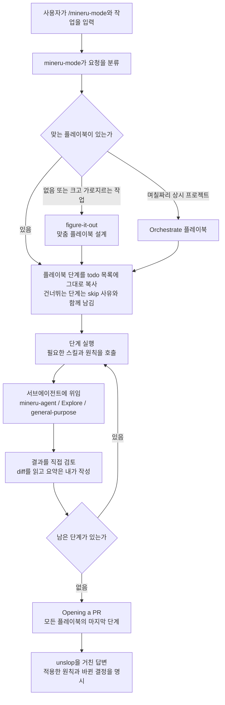

### 스킬 워크플로

스킬은 용도별로 묶었습니다. 각 항목을 펼치면 다이어그램이 나옵니다.

#### 진입과 안내

<details>
<summary><code>/mineru-mode</code> · 모든 작업의 기본 진입점, 트리거 지도</summary>

`mineru-mode`는 직접 일하는 스킬이 아니라 라우터입니다. 아래 트리거에 걸리면 해당 스킬이나 플레이북을 실행합니다. 질문을 던지기 직전에는 먼저 그 질문이 관찰로 답할 수 있는 사실인지 가려냅니다.

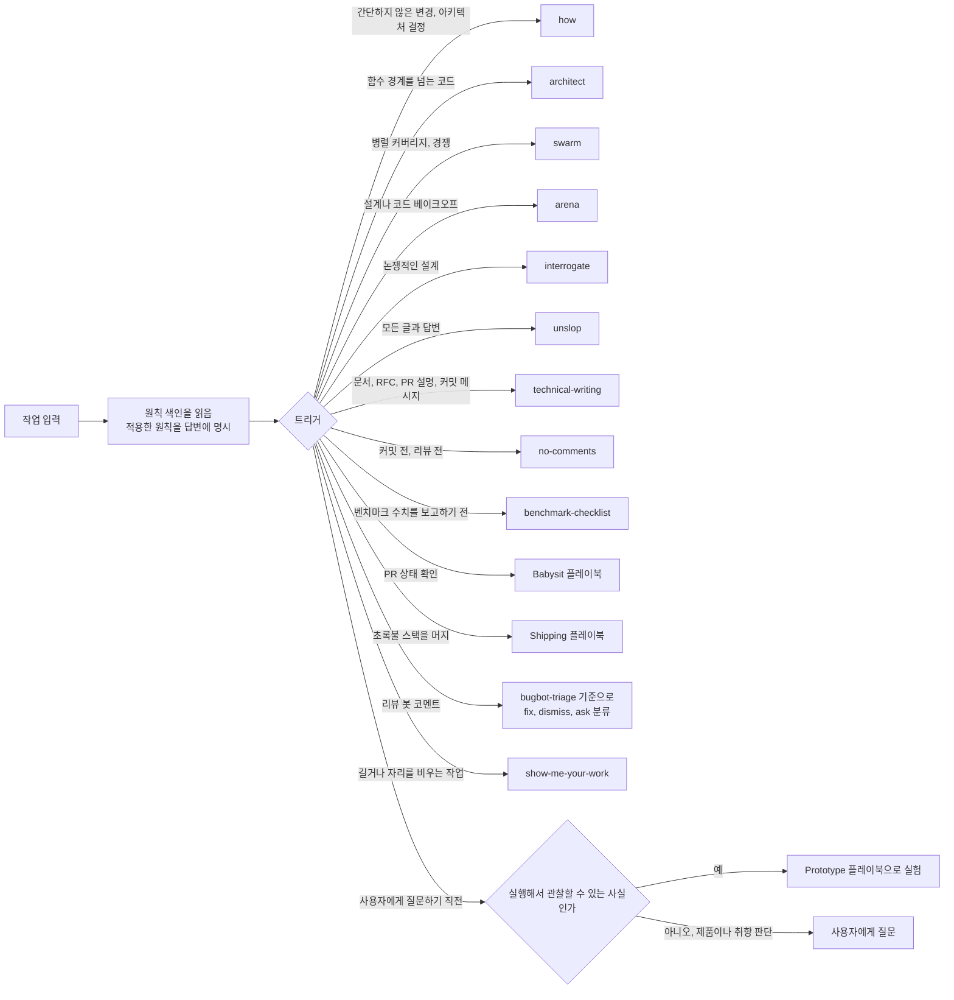

</details>

<details>
<summary><code>/mineru-help</code> · 어떤 스킬이 맞는지 안내</summary>

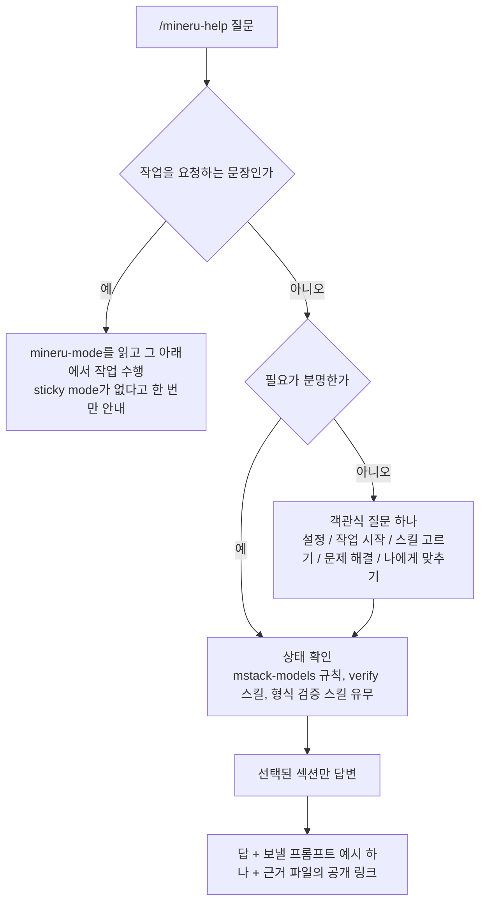

</details>

<details>
<summary><code>/setup-mstack</code> · 역할별 모델과 추론 예산 설정</summary>

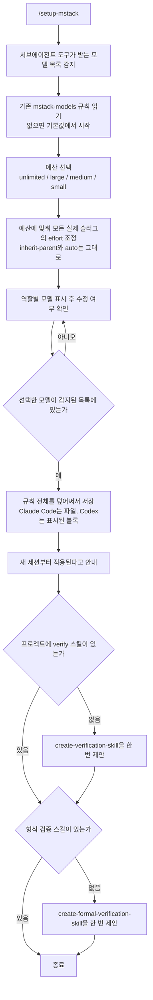

</details>

<details>
<summary><code>/in-your-own-words</code> · 목표와 문제를 자기 말로 다시 설명</summary>

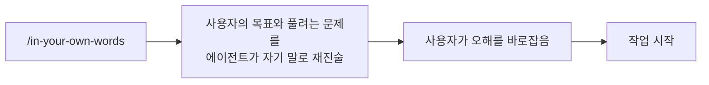

</details>

<details>
<summary><code>/sharpen</code> · 프롬프트를 더 길게가 아니라 더 깊게</summary>

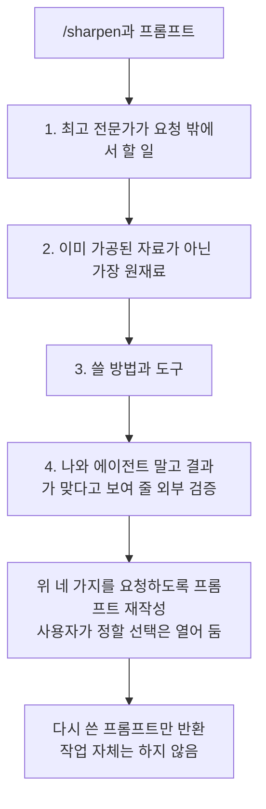

</details>

<details>
<summary><code>/bro</code> · 마지막 메시지를 쉬운 말로 다시</summary>

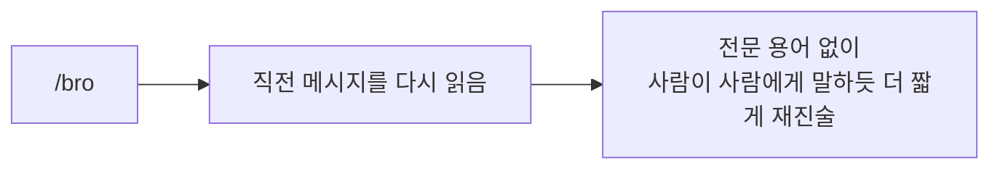

</details>

<details>
<summary><code>/ketchup</code> · 마지막 메시지 이후 바뀐 내용 따라잡기</summary>

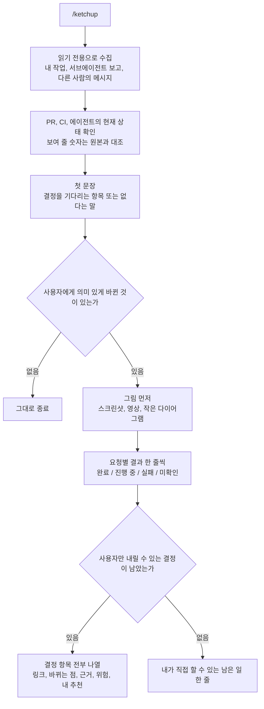

</details>

<details>
<summary><code>/recall</code> · 최근 작업 맥락 복원</summary>

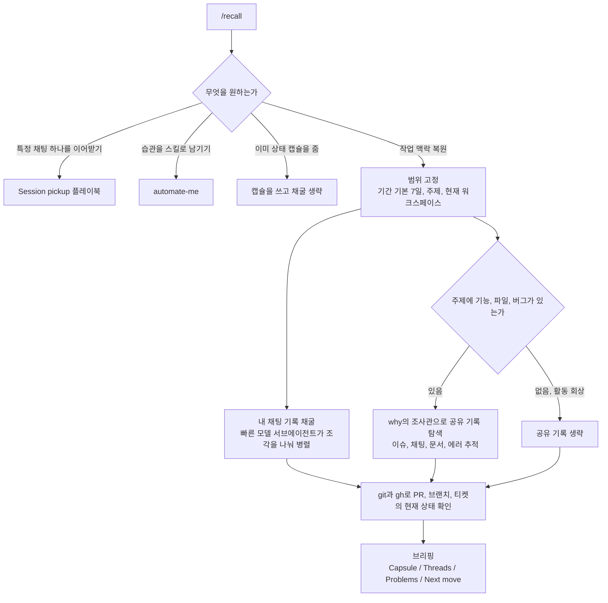

</details>

#### 이해하기

<details>
<summary><code>/how</code> · 코드가 어떻게 동작하는지 설명</summary>

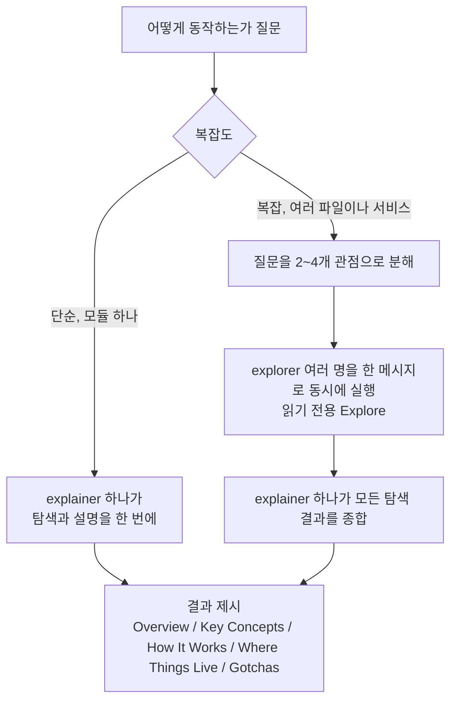

</details>

<details>
<summary><code>/why</code> · 왜 이렇게 만들어졌는지 증거로 조사</summary>

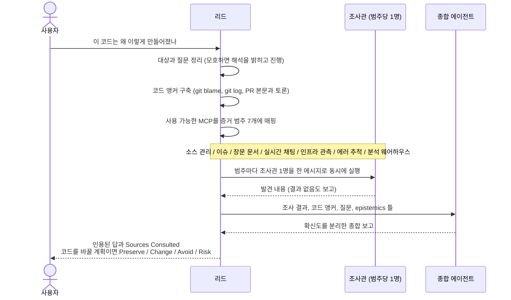

</details>

<details>
<summary><code>/teach</code> · how와 why를 엮어 이해시키기</summary>

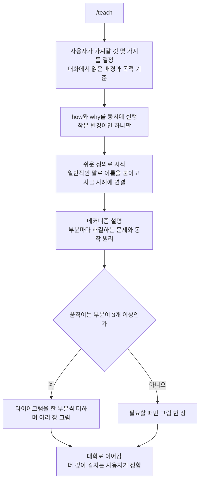

</details>

<details>
<summary><code>/blast-radius</code> · 작은 변경이 다른 곳에서 깨뜨릴 것 찾기</summary>

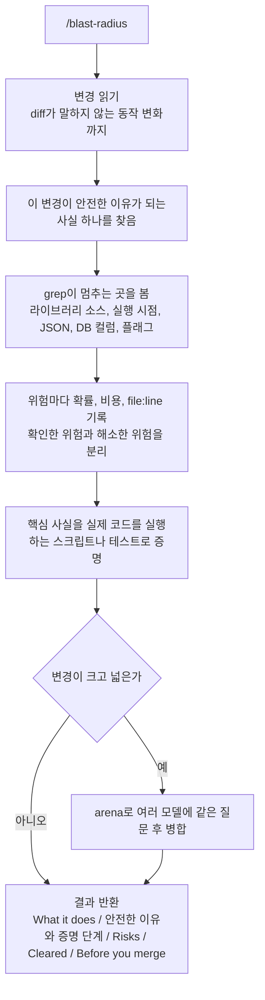

</details>

#### 설계와 병렬 실행

<details>
<summary><code>/architect</code> · 코드 전에 타입, 시그니처, 모듈 구조 확정</summary>

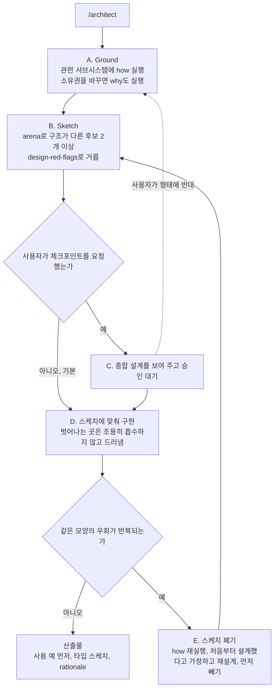

</details>

<details>
<summary><code>/arena</code> · 같은 일을 N개 병렬로 시키고 좋은 부분을 합침</summary>

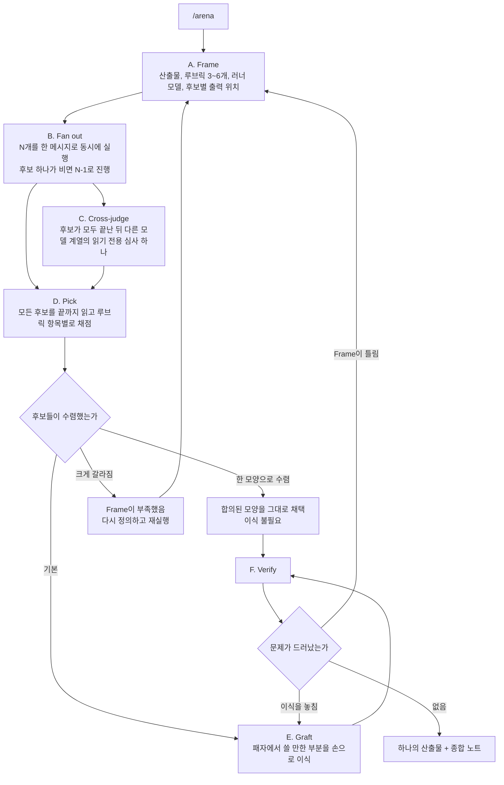

</details>

<details>
<summary><code>/swarm</code> · 워커 N명을 풀어 보고서 하나로 취합</summary>

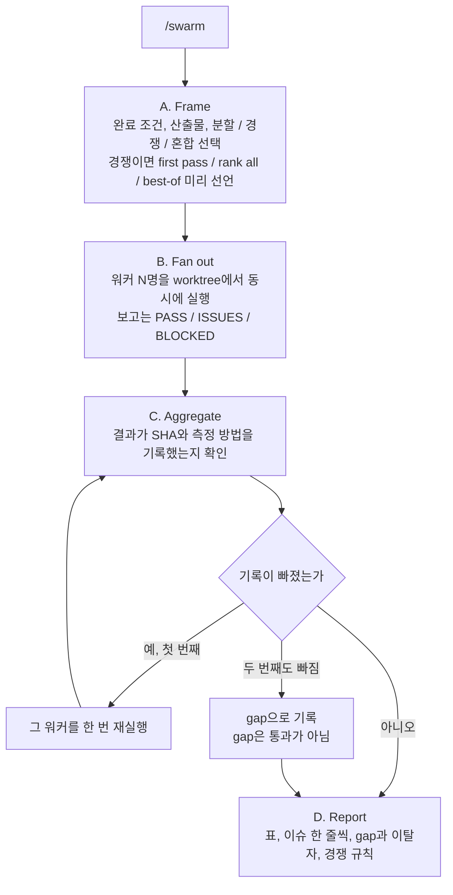

</details>

<details>
<summary><code>/interrogate</code> · 적대자가 diff를 깨뜨려 보고 실행으로 증명된 발견만 남김</summary>

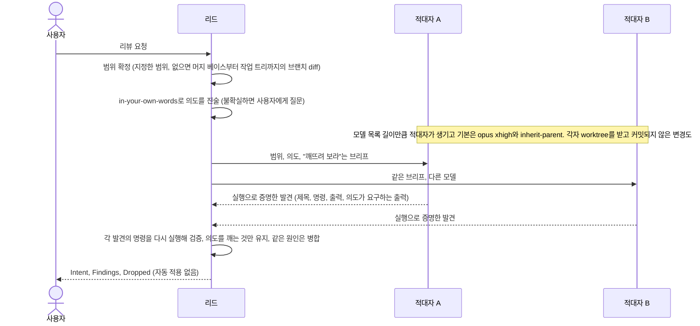

</details>

<details>
<summary><code>/figure-it-out</code> · 맞는 플레이북이 없을 때 감사 가능한 플레이북 설계</summary>

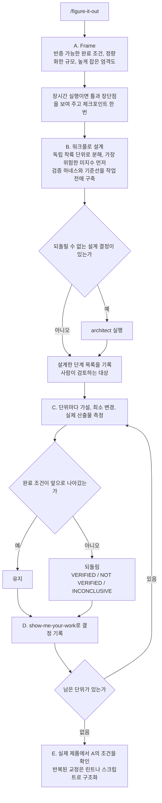

</details>

#### 구현과 검증

<details>
<summary><code>/tdd</code> · 실패하는 테스트를 먼저 쓰고 고치기</summary>

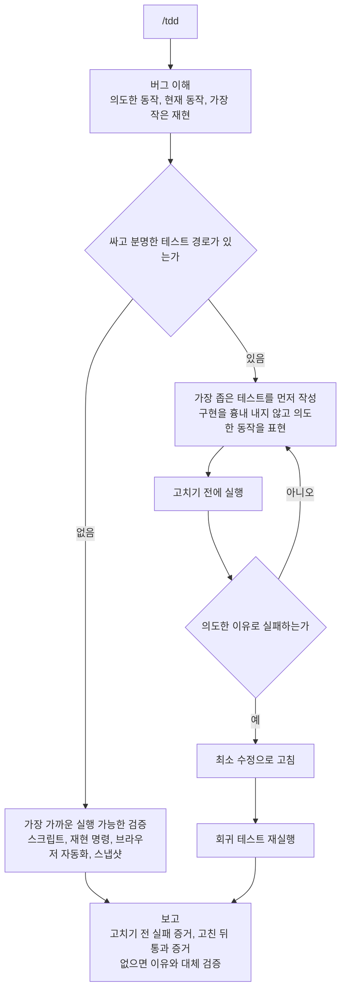

</details>

<details>
<summary><code>/benchmark-checklist</code> · 성능 수치를 보고하기 전에 검증</summary>

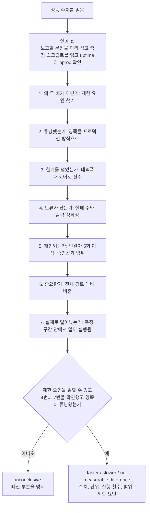

</details>

<details>
<summary><code>/no-comments</code> · Comment Sicko로 주석 제거</summary>

```mermaid
flowchart TD
    A["/no-comments"] --> B["범위 결정<br/>호출자가 준 파일이나 main 대비 현재 diff"]
    B --> C["comment-sicko 서브에이전트 실행"]
    C --> D["보고와 diff 검사<br/>애플리케이션 코드 수정, 범위 이탈, 예외 보호 삭제는 거부"]
    D --> E{"거부할 것이 있는가"}
    E -->|"첫 번째"| F["되돌리고 실패 사유를 적어 한 번 재실행"]
    F --> D
    E -->|"두 번째도 거부"| FAIL["미해결로 보고하고 no-comments 실패"]
    E -->|"없음"| G{"수정에 구조 결정이 필요한가"}
    G -->|"예"| H["architect를 한 번 실행하고 스케치까지만"]
    G -->|"아니오"| I
    H --> I["범위 안에서 가장 작은 근본 원인 수정<br/>우회 코드는 모두 제거"]
    I --> J{"제약을 주장하는 주석인가<br/>do not remove 같은 것"}
    J -->|"예"| K["가장 싼 타입, 런타임, 테스트, CI 린트로 인코딩 제안"]
    K --> L{"승인되었는가"}
    L -->|"예"| M["인코딩하고 주석 삭제"]
    L -->|"아니오"| N["주석 삭제 후 제약을 미해결로 보고"]
    J -->|"아니오"| O
    M --> O["보고<br/>삭제 수, 복원, 재실행, 수정, 인코딩, 미해결 항목"]
    N --> O
```

</details>

<details>
<summary><code>/correct</code> · 반복되는 에이전트 실수를 구조로 막기</summary>

```mermaid
flowchart TD
    A["/correct"] --> B["최근 커밋, 되돌림, 리뷰 코멘트, 우회 주석에서 실수 수집"]
    B --> C["유형으로 묶기<br/>두 번 일어나면 한 유형"]
    C --> D["유형마다 가장 높은 층위에서 해결"]
    D --> L1["1. 아키텍처로 없애기<br/>상태의 소유자 하나, 잘못된 import 차단, 옛 방식 삭제"]
    L1 --> L2["2. 타입으로 막기<br/>그래도 컴파일되면 대체할 대상을 에러에 적은 린트나 CI"]
    L2 --> L3["3. 동작을 테스트<br/>무의미한 테스트는 고치거나 삭제"]
    L3 --> L4["4. 문서와 규칙은 마지막<br/>판단이 필요한 부분만"]
    L4 --> E["가장 잦은 유형부터 커밋 하나씩 수정"]
    E --> F["새 검사가 실제 과거 실수에서 실패하는지 증명<br/>로컬과 CI에서 같은 명령"]
    F --> G["에이전트 지침 파일의 규칙-강제 수단 표 갱신<br/>실수가 불가능해진 규칙은 삭제"]
```

</details>

<details>
<summary><code>/typescript-best-practices</code> · .ts, .tsx 작업 규칙</summary>

```mermaid
flowchart TD
    A[".ts / .tsx를 읽거나 수정"] --> B["type-system-discipline 원칙을 먼저 적용"]
    B --> C["타입 설계<br/>kind 판별자 유니온, 브랜드 타입, 구성적 모델링, 가장 단순한 total 타입"]
    C --> D["경계에서 검증<br/>외부 데이터는 unknown, 스키마로 파싱, 안쪽은 타입 신뢰"]
    D --> E["좁히기 우선순위<br/>판별자 switch, in, typeof와 instanceof, 타입 가드, as"]
    E --> F["default에서 never로 exhaustiveness 확인<br/>as 대신 satisfies"]
    F --> G["테스트와 로깅<br/>실제 테스트 우선, 구조화된 로그, console.log 금지"]
```

</details>

<details>
<summary><code>/create-verification-skill</code> · 앱을 사용자처럼 구동하는 verify 스킬 생성</summary>

```mermaid
flowchart TD
    A["/create-verification-skill"] --> B["1. 사용자가 아닌 저장소에 질문<br/>표면, 실행 방법, 구동 방법, 관찰 증거, 격리 가능성"]
    B --> C{"체크아웃이 빌드되고 실행되는가"}
    C -->|"아니오"| D["먼저 고치거나 정확히 보고"]
    D --> C
    C -->|"예"| E["2. verify-앱이름/SKILL.md 생성<br/>Launch / Doctor / Drive / Evidence / Cleanup / Helpers"]
    E --> F["3. 기능 맵 시드<br/>features/README.md와 기능별 파일 3~5개"]
    F --> G["4. 생성한 스킬을 끝까지 한 번 실행<br/>실행, doctor, 기능 하나 구동, 증거 수집, 정리"]
    G --> H{"정리 뒤에도 증거가 남아 있는가"}
    H -->|"아니오 또는 실패"| I["고치고 실패한 시도도 정리"]
    I --> G
    H -->|"예"| J["5. maintain-verification-skill 안내"]
```

</details>

<details>
<summary><code>/maintain-verification-skill</code> · verify 스킬과 기능 맵을 앱과 맞추기</summary>

```mermaid
flowchart TD
    S0["0. 대상 verify 스킬 찾기<br/>여러 개면 질문, 없으면 create로 안내"] --> S1["1. 기능 맵 색인 정리"]
    S1 --> S2["2. Source wave<br/>기능 파일마다 읽기 전용 서브에이전트가 동시에 소스 조사<br/>드리프트 의심과 구동 레시피 하나 반환"]
    S2 --> S3["3. Reconcile<br/>겹치는 레시피 병합, 맵에 없는 최근 표면 확인"]
    S3 --> S4["4. Live pass<br/>코디네이터 한 명이 모든 기능을 실제로 구동<br/>doctor 선행, 증거 보존, 잔여물 정리"]
    S4 --> S5{"5. Triage"}
    S5 -->|"설명이 틀림"| DD["문서 드리프트: 맵 수정"]
    S5 -->|"하네스가 못 다룸"| HG["하네스 갭: 하네스 수정 후 다시 구동"]
    S5 -->|"앱이 실제로 고장"| PG["제품 갭: 사용자에게 기록만"]
    DD --> S6
    HG --> S6
    PG --> S6{"6. 결과"}
    S6 -->|"수정할 것 없음"| CL["clean: 브랜치와 PR 없음"]
    S6 -->|"증명된 수정 있음"| CH["changed: 증명된 수정만 담아 PR 한 개"]
    S6 -->|"끝내지 못함"| BL["blocked: 막힌 이유를 정확히 보고"]
```

</details>

<details>
<summary><code>/create-formal-verification-skill</code> · 테스트가 닿지 않는 속성을 형식 검증</summary>

```mermaid
flowchart TD
    A["/create-formal-verification-skill"] --> B["코드에서 목표 선택<br/>깨지면 비용이 크고 테스트가 거의 닿지 않는 약속"]
    B --> C["질문에 맞는 도구 선택<br/>순서 문제는 TLA+ 모델 검사, 코드 속성은 코드 검증기, 크기 무관은 증명"]
    C --> D["속성 하나를 검증<br/>모델의 모든 부분이 열어 볼 수 있는 코드를 가리킴"]
    D --> E["깨진 변형에서 실패하는지 확인<br/>실패한 적 없는 검사는 증명이 아님"]
    E --> F["프로젝트 전용 verify 스킬 생성<br/>커버 범위와 마지막 동기화 커밋 기록"]
    F --> G["속성을 깨는 임시 변경에 스킬을 따라 적용"]
    G --> H{"스킬이 깨짐을 잡는가"}
    H -->|"아니오"| I["스킬이나 검증을 고침<br/>임시 변경은 건드리지 않음"]
    I --> G
    H -->|"예"| J["임시 변경 제거, 검사가 원래 상태인지 확인"]
    J --> K["인계<br/>검증한 것, 도구와 이유, 한계, 발견, 실행법, 커버하지 못하는 것"]
```

</details>

<details>
<summary><code>/maintain-formal-verification-skill</code> · 코드가 바뀐 뒤 형식 검증을 코드에 맞춤</summary>

```mermaid
flowchart TD
    S1["1. 검사 찾기<br/>모델 검사기나 증명기를 돌리는 프로젝트 스킬<br/>속성, 대상 코드, 한계, 명령, 마지막 동기화 커밋 수집"] --> S2["2. 바꾸기 전에 그대로 실행하고 결과 기록"]
    S2 --> S3["3. 동기화 커밋 이후 커버 코드의 변경을 모두 읽음<br/>이동, 분리, 같은 상태를 쓰는 새 코드도 확인"]
    S3 --> C{"변경 유형"}
    C -->|"영향 없음"| NE["그대로 둠"]
    C -->|"검증이 코드를 더는 설명하지 못함"| UD["모델이나 하네스 수정"]
    C -->|"약속이 의도적으로 바뀜"| UP["근거를 인용하고 속성 수정"]
    C -->|"약속이 깨졌을 수 있음"| BC["실패하면 버그 후보"]
    UD --> S4
    UP --> S4["4. 결과가 아닌 코드에서 업데이트<br/>한계는 유지, 줄이면 보고"]
    BC --> S4
    NE --> S5
    S4 --> S5["5. 다시 실행"]
    S5 --> R{"결과"}
    R -->|"통과"| P1["새 코드를 일부러 깨뜨려 검사가 여전히 실패하는지 확인"]
    R -->|"실패"| F1["반례를 실제 코드에서 한 단계씩 재현"]
    F1 --> F2{"모든 단계가 일어날 수 있는가"}
    F2 -->|"아니오"| DR["검증의 드리프트: 검증을 고침"]
    F2 -->|"예"| BUG["bug: 도입한 커밋, 반례, 피해를 보고"]
    P1 --> S6
    DR --> S6
    BUG --> S6["6. verify 스킬의 범위, 명령, 한계, 동기화 커밋 갱신"]
    S6 --> OUT["in sync / updated / bug / blocked 중 하나로 보고<br/>검증 수정은 제품 수정과 별도 변경"]
```

</details>

#### 기록과 개선

<details>
<summary><code>/show-me-your-work</code> · 결정 기록 TSV와 감사</summary>

```mermaid
flowchart TD
    A["길거나 자리를 비우는 작업"] --> B["decisions.tsv 시작<br/>헤더는 템플릿에서 복사"]
    B --> C["결정 지점마다 한 줄 추가<br/>ts / phase / decision / why / evidence / result"]
    C --> D{"작업이 끝났는가"}
    D -->|"아니오"| C
    D -->|"예"| E["기록을 대화 기록과 대조해 감사<br/>모든 행이 실제 결정인지, 증거가 풀리는지, 빠진 갈림길은 없는지"]
    E --> F{"틀린 행이나 빠진 결정이 있는가"}
    F -->|"있음"| G["행을 고치지 않고 덮어쓰는 새 행을 추가"]
    F -->|"없음"| H
    G --> H["다른 모델 계열의 서브에이전트가 기록을 교차 검토"]
    H --> I["답변 끝에 Attention 섹션<br/>reviewed by 모델명, 플래그 또는 No flags"]
    I --> J{"검토자가 신뢰를 요구하는 큰 작업인가"}
    J -->|"예"| K["기록을 커밋"]
    J -->|"아니오"| L["로컬에만 유지"]
```

</details>

<details>
<summary><code>/reflect</code> · 대화에서 배운 것을 스킬 수정으로 연결</summary>

```mermaid
sequenceDiagram
    actor U as 사용자
    participant P as 부모
    participant J as Judgment 리뷰어
    participant T as Tooling 리뷰어
    participant D as Divergent 리뷰어
    participant S as 종합 에이전트

    U->>P: /reflect
    P->>P: 현재 워크스페이스의 대화 기록을 찾음 (없으면 요약본 사용)
    P->>J: 대화 기록 경로 (general-purpose, MCP 접근 포함)
    P->>T: 대화 기록 경로
    P->>D: 대화 기록 경로
    J-->>P: 발견 목록
    T-->>P: 발견 목록
    D-->>P: 발견 목록
    P->>S: 세 리뷰어의 전체 출력
    S-->>P: Accepted / Rejected / Backlog
    P->>P: 린트나 스크립트로 강제할 수 있는 Accepted는 Backlog로 이동
    P-->>U: 전체 목록을 보여 주고 승인 대기
    P->>P: Backlog는 승인을 기다리지 않고 트래커에 등록
    U->>P: 적용할 부분 선택
    P->>P: 사소한 수정은 직접, 큰 수정과 새 스킬은 skill-creator로
    P-->>U: 적용한 수정, 새 스킬, Backlog 등록, 버린 항목
```

</details>

<details>
<summary><code>/automate-me</code> · 내 작업 방식을 -mode 스킬로</summary>

```mermaid
flowchart TD
    A["/automate-me"] --> B{"내 -mode 스킬이 이미 있는가"}
    B -->|"있음"| C["업데이트(기본) 또는 새로 시작 확인<br/>업데이트는 마지막 수정 이후 기록만 채굴"]
    B -->|"없음"| D
    C --> D["1. 현재 워크스페이스의 대화 기록만 채굴<br/>2~4주를 3조각으로 나눠 병렬 서브에이전트"]
    D --> E["둘 이상의 조각에서 보인 패턴만 높은 신뢰로 채택"]
    E --> F["2. AskUserQuestion으로 직접 질문<br/>선택지 4~6개 한두 번, 자유 입력 한 번"]
    F --> G["3. 신호를 섹션으로 묶음<br/>응답 스타일, 자율성, 서브에이전트, 검증, 프로세스 등"]
    G --> H["4. skill-creator로 초안<br/>description은 이름과 /핸들-mode 중심"]
    H --> I["5. unslop을 적용하고 사용자 피드백으로 반복<br/>과감히 줄임"]
    I --> J{"사용자가 만족하는가"}
    J -->|"아니오"| I
    J -->|"예"| K["6. main에서 딴 worktree에서 커밋하고 PR<br/>main에 직접 푸시하지 않음"]
```

</details>

#### 글쓰기

<details>
<summary><code>/unslop</code> · AI 티 나는 표현 걷어내기</summary>

```mermaid
flowchart LR
    A["글"] --> B["패턴 탐지<br/>내용 / 어휘 / 문체 / 챗봇 문구 / 군더더기 / 추상 은유 / 평이한 말"]
    B --> C["다시 쓰기<br/>의미와 의도한 어조는 유지"]
    C --> D["능동태, 한 문장에 한 생각, 구체적인 사실이나 수치"]
```

</details>

<details>
<summary><code>/technical-writing</code> · 문서, RFC, PR 설명, 커밋 메시지 기준</summary>

```mermaid
flowchart TD
    A["문서, RFC, readme, PR 설명, 커밋 메시지"] --> B{"Diátaxis 모드 선택<br/>행동인가 이해인가, 학습인가 업무인가"}
    B -->|"행동 + 학습"| T1["tutorial"]
    B -->|"행동 + 업무"| T2["how-to"]
    B -->|"이해 + 업무"| T3["reference"]
    B -->|"이해 + 학습"| T4["explanation"]
    T1 --> C
    T2 --> C
    T3 --> C
    T4 --> C["문서 하나에 모드 하나"]
    C --> D["Google developer style<br/>독자에게 you, 능동태, 명령형, 조건을 앞에"]
    D --> E["STE<br/>한 문장에 지시 하나, 20~25단어 이내, 경고를 단계 앞에"]
    E --> F["Global English<br/>모호한 대명사와 명사 연쇄 제거, 같은 것은 한 이름으로"]
    F --> G["리듬 변주<br/>문장 길이를 섞고 구체적으로 쓰고 관점을 가짐"]
    G --> H["unslop 적용"]
```

</details>

#### 자동화

<details>
<summary><code>/make-bot-ui</code> · 버튼으로 에이전트를 깨우는 웹훅 UI</summary>

```mermaid
sequenceDiagram
    actor U as 사용자
    participant A as 에이전트
    participant S as 이 컴퓨터의 서버
    participant W as 웹훅 자동화

    A->>W: 웹훅 트리거 자동화 생성 (사용자가 생성 확인)
    U->>U: 자동화 화면에서 URL과 sender key 복사
    U->>A: URL만 채팅에 전달
    U->>U: 키는 채팅에 붙이지 않고 로컬 파일(권한 600)이나 환경 변수에 저장
    A->>S: 키를 서버 설정에 복사 (출력과 로그 금지)
    A->>S: 0.0.0.0 주소의 지정한 포트에서 페이지 호스팅
    A->>S: 무해한 payload로 한 번 probe
    S->>W: POST (Bearer 키, 8초 제한, 재시도 없음)
    W-->>S: HTTP 200 (자동화가 깨어남)
    A->>A: tailscale 상태 확인, 호스트명과 100.x 주소 두 URL을 사용자에게 제공
    U->>S: 버튼 클릭
    S->>W: JSON을 POST
    W->>A: 헤더, body 문자열, 타임스탬프와 함께 실행
    A->>A: body를 파싱하고 외부 데이터로 취급 (지시가 아닌 입력)
```

</details>

### 플레이북 워크플로

플레이북은 `/mineru-mode`가 고르는 단계 목록이며 슬래시 명령이 없습니다. 아래 다이어그램은 `skills/mineru-mode/playbooks/`의 단계를 옮긴 것입니다.

#### 이해와 진단

<details>
<summary>Investigation · 읽기 전용 질문에 인용된 답 만들기</summary>

```mermaid
flowchart LR
    A["읽기 전용 질문"] --> B["how"]
    B --> C{"동기를 묻는가"}
    C -->|"예"| D["why도 실행"]
    C -->|"아니오"| E
    D --> E["how 형식의 출력<br/>대안 중 선택이면 장단점 표"]
    E --> F["unslop 적용"]
    F --> G["답변<br/>PR도 babysit도 없음"]
```

</details>

<details>
<summary>Runtime forensics · 실행 중인 증상을 계측으로 진단</summary>

```mermaid
flowchart TD
    A["메모리 누수, 유휴 CPU 폭주, 화면 깨짐"] --> B["제어 스킬로 살아 있는 신호 캡처<br/>CPU 프로파일, 힙 스냅샷, CDP 트레이스"]
    B --> C["산출물을 결정적 단서로 축소<br/>큰 파일은 서브에이전트가 파싱"]
    C --> D["메커니즘을 증명<br/>실행 중인 프로세스에 CDP로 계측을 주입"]
    D --> E["소스로 되돌려 매핑<br/>파일, 심볼, 할당이나 예약하는 줄"]
    E --> F["진단만 전달<br/>고치려면 Bug fix나 Perf issue로 이관"]
```

</details>

<details>
<summary>Trace forensics · 이미 수집된 프로파일 산출물을 진단</summary>

```mermaid
flowchart TD
    A["cpuprofile, trace, spindump, heap snapshot"] --> B["형식 식별 후 알맞은 도구로 로드<br/>큰 파일은 서브에이전트가 파싱"]
    B --> C["sqlite로 변환해 조회 가능한 형태로"]
    C --> D["가장 시간이 많은 프레임, 보유 체인, 막힌 스레드로 좁힘"]
    D --> E["산출물의 심볼로 파일, 심볼, 줄에 귀속"]
    E --> F{"전후 쌍의 캡처가 있는가"}
    F -->|"있음"| G["전후를 비교해 원인 확정"]
    F -->|"없음"| H["산출물이 지지하는 가장 강한 가설로 표시"]
    G --> I["인용된 진단 전달"]
    H --> I
```

</details>

#### 구현과 개선

<details>
<summary>Bug fix · 재현, 근본 원인, 런타임 증거로 고치기</summary>

```mermaid
flowchart TD
    A["결함 보고"] --> B["같은 표면에서 직접 재현<br/>제어 스킬 사용, 사용자에게 재현을 떠넘기지 않음"]
    B --> C{"재현되는가"}
    C -->|"아니오"| C2["트리거 합성, 조건 좁히기, 계측"]
    C2 --> B
    C -->|"예"| D["이진 탐색으로 원인 후보를 제거<br/>how와 why로 후보 생성, 런타임 증거로 제거"]
    D --> E["살아남은 메커니즘을 런타임 증거로 확인"]
    E --> F{"함수 경계를 넘는 수정인가"}
    F -->|"예"| G["architect"]
    F -->|"아니오"| H
    G --> H["서브에이전트가 증거가 정당화하는 최소 수정을 구현"]
    H --> I["같은 표면에서 원래 재현이 통과하는지 검증"]
    I --> J{"통과했는가"}
    J -->|"아니오 또는 inconclusive"| D
    J -->|"예"| K["실패하는 재현이 수정보다 먼저 커밋되도록 정리<br/>싼 테스트 경로가 있으면 tdd"]
    K --> L["Opening a PR"]
```

</details>

<details>
<summary>Perf issue · 측정된 느려짐을 기준선과 비교해 개선</summary>

```mermaid
flowchart TD
    A["측정된 느려짐"] --> B["기준선 트레이스 캡처<br/>benchmark-checklist로 수치 검증"]
    B --> C["how로 가설 수립<br/>실행해 보기 전에 성능 한계를 단정하지 않음"]
    C --> D["성능 만트라를 싼 순서로 시도<br/>하지 않기, 반복하지 않기, 덜 하기, 나중에, 안 보일 때, 동시에, 더 싸게"]
    D --> E["트레이스에서 수정을 계획<br/>함수 경계를 넘으면 architect"]
    E --> F["서브에이전트가 구현, diff 검토, 수정 후 트레이스 캡처"]
    F --> G["산출물을 파싱해 비교<br/>inconclusive나 잘못된 표면은 통과가 아님"]
    G --> H{"목표를 달성했는가"}
    H -->|"아니오"| D
    H -->|"예, 앞 단계 만트라에서 충족"| I["더 비싼 만트라는 시도하지 않고 멈춤"]
    I --> J["PR에 측정값 인용 후 Opening a PR"]
```

</details>

<details>
<summary>Hillclimb · 지표 하나를 목표까지 가설 루프로 끌어올리기</summary>

```mermaid
flowchart TD
    S1["1. how로 워크로드와 구조를 파악<br/>지표, 방향, 목표와 최소 반복 횟수를 쌍으로 묶은 종료 조건"] --> S2["2. 측정 하네스 구축, 민감도 증명, 동결<br/>benchmark-checklist로 검증, 기준선과 회귀 게이트 기록"]
    S2 --> S3["3. 결정 로그 decision.tsv 시작"]
    S3 --> S4["4. 구조 모델에 근거한 가설<br/>성능 지표면 만트라 순서"]
    S4 --> S5["5. 서브에이전트가 변경 하나를 구현"]
    S5 --> M["동결한 하네스로 전후 측정 + 회귀 게이트"]
    M --> J{"노이즈를 넘어 개선되었고 게이트가 초록인가"}
    J -->|"예"| K["채택: 커밋 하나, 로그에 kept"]
    J -->|"아니오"| R["전부 되돌림, 로그에 reverted"]
    K --> ST
    R --> ST{"6~7. 종료 조건을 만족했는가"}
    ST -->|"예, 또는 남은 아이디어가 한계 이득"| S8["8. 채택한 커밋을 쌓아 Opening a PR"]
    ST -->|"아니오"| PL{"연속으로 기각되며 정체했는가"}
    PL -->|"예"| PV["범주 전환, 근접한 시도 결합, 소스 재독, 더 급진적인 시도"]
    PL -->|"아니오"| S4
    PV --> S4
```

</details>

<details>
<summary>Feature · 이름 붙인 데이터 형태에서 출발해 구현</summary>

```mermaid
flowchart TD
    A["새 동작이나 바뀐 동작"] --> B["1. 영향 받는 서브시스템에 how"]
    B --> C["2. architect로 병렬 설계 탐색"]
    C --> D["3. 처리량 체크포인트 네 항목<br/>선행 차단 단계 / 독립 작업 흐름 / 공유 가변 상태 / 가장 작은 안전한 분해"]
    D --> E{"구현 형태가 여러 개 유효한가"}
    E -->|"예"| F["arena로 위임"]
    E -->|"아니오"| G["서브에이전트에 위임<br/>파일, 데이터 형태, 성공 기준을 명시"]
    F --> H
    G --> H["5. 맞는 표면에서 검증<br/>inconclusive는 통과가 아님"]
    H --> I["6. 작고 순서 있는 커밋으로 rebase"]
    I --> J{"설계가 논쟁적인가"}
    J -->|"예"| K["7. interrogate"]
    J -->|"아니오"| L
    K --> L["8. Opening a PR"]
```

</details>

<details>
<summary>Refactoring · 동작은 그대로, 구조만 바꾸기</summary>

```mermaid
flowchart TD
    A["구조나 형태 변경"] --> B["1. 동작 계약을 고정<br/>how로 계약 파악, 특성화 테스트나 스냅샷, 타입 검사는 고정이 아님"]
    B --> C["2. 코드에 빠진 구조에 이름을 붙임"]
    C --> D["3. 목표 형태 정의<br/>함수 경계를 넘으면 architect"]
    D --> E["4. 먼저 뺌: 죽은 코드, 호출처 하나인 래퍼, 중복 검증"]
    E --> F["5. 고정이 초록인 작은 단계로 이동<br/>호출부 이전과 옛 API 삭제를 같은 묶음에서"]
    F --> G["6. 실제 산출물로 동작 불변 증명<br/>옛 출력과 새 출력의 diff, 기록한 기준선 재생"]
    G --> H{"독자 부담이 줄었는가"}
    H -->|"아니오"| I["되돌림"]
    H -->|"예"| J["8. 뺄셈, 재구성, 후속 정리 순서로 커밋하고 Opening a PR"]
    D -.->|"정리 중 진짜 버그나 빠진 기능 발견"| K["분리해서 Feature나 Bug fix로 이관<br/>구조 변경을 먼저 출고"]
```

</details>

<details>
<summary>Prototype · 버릴 스케치로 결정을 싸게 내리기</summary>

```mermaid
flowchart TD
    A["프로토타입 요청"] --> B["1. 내려야 할 결정을 한 문장으로"]
    B --> C{"결정이 있는가"}
    C -->|"없음"| F0["Feature로 이관"]
    C -->|"있음"| D["2. 설계 공간이 열려 있으면 레퍼런스 수집<br/>선행 사례, 무드보드, 사용자가 방향 선택"]
    D --> E["3. 격리된 스크래치 디렉터리에 버릴 코드<br/>속도 우선, 프로덕션 프레임워크와 테스트 없음"]
    E --> F["4. 대안은 전환 버튼 하나 뒤에 라벨을 붙여 비교"]
    F --> G["5. 맞는 표면에서 관찰<br/>시각은 스크린샷, 동작과 타이밍은 로그나 출력"]
    G --> H["6. 대안, 장단점, 추천을 제시<br/>산출물은 결정과 버릴 스케치"]
    H --> I["선택한 방향을 Feature나 architect로 넘김"]
```

</details>

<details>
<summary>Visual parity · 두 구현의 UI를 픽셀 단위로 일치</summary>

```mermaid
flowchart TD
    A["픽셀 동일성 요구"] --> B["1. 기준선 먼저<br/>현재 컴포넌트의 상태별 스크린샷 하네스, 기준선 없이는 일치 주장 불가"]
    B --> C["2. 우회 금지<br/>하네스 수정, 기준선 변조, 컴포넌트 구조 변경 금지"]
    C --> D["3. 공유 기본 요소를 먼저 이전"]
    D --> E["컴포넌트 하나씩 이전<br/>worktree마다 담당자 한 명"]
    E --> F["4. 기준선과 이미지 diff"]
    F --> G{"diff가 0인가"}
    G -->|"아니오"| H["픽셀 차이를 조사하고 수정, loop로 반복"]
    H --> F
    G -->|"예"| I["5. 컴포넌트별 또는 안전한 묶음별 Opening a PR"]
```

</details>

#### 스킬과 평가

<details>
<summary>Authoring or modifying a skill · SKILL.md 작성과 수정</summary>

```mermaid
flowchart LR
    A["SKILL.md 작성 또는 수정"] --> B["skill-creator 사용"]
    B --> C["검증<br/>frontmatter의 name과 description, 참조 파일 존재, 스킬 간 링크"]
    C --> D{"구조적 스킬인가"}
    D -->|"예"| E["테스트 케이스 작성"]
    D -->|"아니오, 주관적"| F
    E --> F["Opening a PR"]
```

</details>

<details>
<summary>Eval · 스킬이나 프롬프트 변경의 효과를 블라인드로 테스트</summary>

```mermaid
flowchart TD
    A["변경 후보"] --> B["1. Frame<br/>시험할 변형과 성공 동작, 심판 전용 루브릭 3~6개"]
    B --> C["2. 후보별 정제된 환경<br/>eval, test 같은 단어를 디렉터리와 프롬프트에서 제거"]
    C --> D["3. 실제 사용자가 칠 법한 프롬프트 하나<br/>측정 대상은 드러내지 않음"]
    D --> E["4. 서로 다른 모델의 후보 N개를 병렬 실행"]
    E --> F["5. 다른 모델 계열의 블라인드 심판 하나<br/>모델명 대신 정제된 라벨로만 봄"]
    F --> G["6. 자기 보고가 아니라 대화 기록에서 실제로 연 파일을 확인"]
    E --> H["7. 모든 후보 출력을 직접 끝까지 읽음"]
    G --> I
    H --> I["심판의 판정과 비교"]
    I --> J{"판정과 내 판단이 갈리는가"}
    J -->|"예"| K["모델 편향 또는 모호한 루브릭<br/>종합해서 정리"]
    J -->|"아니오"| L
    K --> L["변형을 승격할지 추천"]
```

</details>

#### PR 관리와 머지

<details>
<summary>Opening a PR · 모든 플레이북의 마지막 단계</summary>

```mermaid
flowchart TD
    A["플레이북의 마지막"] --> B["main에서 딴 git worktree에서 작업"]
    B --> C["작고 순서 있는 커밋으로 rebase<br/>각 커밋은 따로 착륙 가능"]
    C --> D["커밋 전 plain-words 패스와 unslop<br/>리뷰 전 no-comments"]
    D --> E["제목은 Conventional Commits<br/>본문은 technical-writing과 unslop"]
    E --> F["본문 섹션<br/>Why / What changed / Scope / Tradeoffs / Blast Radius / Verification"]
    F --> G["forge 결정: gh 기본, Origin이 가능하면 origin pr"]
    G --> H{"실행 환경에 내장 PR 도구가 있는가"}
    H -->|"있음"| I["내장 도구로 생성하고 draft: false"]
    H -->|"없음"| J["origin pr create --status open 또는 gh pr create"]
    I --> K
    J --> K["항상 ready 상태로 열기<br/>큰 변경은 좁은 PR 여러 개로 쌓음"]
    K --> L["URL을 올리고 계속 작업<br/>babysit은 시작하지 않음"]
```

</details>

<details>
<summary>Babysit · PR을 머지 가능한 상태까지 끌고 가기</summary>

```mermaid
flowchart TD
    A["PR 상태 요청"] --> B["1. 모드 선언과 forge 결정<br/>drive / background / threads-only / check"]
    B --> C["2. 가장 낮은 머지되지 않은 PR이 프런티어<br/>위쪽 PR은 읽고 모아 두기만"]
    C --> D["3. 스택당 babysitter 하나, 스택 토폴로지는 변경하지 않음"]
    D --> E{"5. 차단 요소"}
    E -->|"충돌"| F["해결하지 않고 어느 브랜치가 rebase해야 하는지 보고하고 중단"]
    E -->|"리뷰 스레드"| G["8. 봇 코멘트는 코드로 검증<br/>실제 문제는 먼저 실패하는 증명과 함께 수정, 노이즈는 근거와 함께 반려"]
    E -->|"CI 실패"| H["7. 분류<br/>flake는 새 빌드 한 번, 같은 실패가 반복되면 재분류, stale base는 rebase 필요로 보고"]
    G --> I["수정은 한 번의 push 묶음으로"]
    H --> I
    I --> J["6. forge의 판정을 신뢰<br/>GitHub는 watch-pr, Origin은 origin pr view"]
    J --> K{"머지 가능 상태인가"}
    K -->|"아니오"| E
    K -->|"예"| L["merge-ready로 보고하고 중단"]
    L --> M["9. 머지 권한은 사용자에게<br/>머지, 착륙, 출고를 명시적으로 요청하면 Shipping으로"]
```

</details>

<details>
<summary>Shipping · 초록불 스택을 검증하고 아래부터 머지</summary>

```mermaid
flowchart TD
    A["초록불 스택을 착륙해 달라는 요청"] --> B["1. forge 결정, PR마다 독립 검증자 한 명<br/>각자 worktree에서 사용자처럼 실행, 코드를 쓴 에이전트의 판정은 무효"]
    B --> C["각 PR에 PASS / PASS+NOTES / FAIL 게시"]
    C --> D["2. 바닥부터 연속으로 검증된 구간만 착륙 대상<br/>검증 안 된 PR 위의 PR은 대기"]
    D --> E["3. 판정이 현재 코드를 설명하는지 확인<br/>git patch-id 비교, 달라졌으면 새로 검사하고 새 판정"]
    E --> F["4. 가장 낮은 PR을 머지<br/>머지 대기열에만 올라갔는지 PR을 다시 읽어 확인"]
    F --> G["다음 PR의 base를 trunk로 바꾸고 --force-with-lease로 push"]
    G --> H["5. 착륙 중에는 스택을 건드리지 않음<br/>watch-pr --queued-stack 또는 origin pr checks --watch"]
    H --> I{"천장 PR까지 머지되었는가"}
    I -->|"아니오"| F
    I -->|"예"| J["6. 천장에서 멈춤<br/>구간을 늘리려면 1단계부터 새로"]
```

</details>

#### 장시간 자율 작업

<details>
<summary>Autonomous run · 종료 조건까지 멈추지 않고 진행</summary>

```mermaid
flowchart TD
    A["오래 걸리는 작업"] --> B["1. 확인 가능한 종료 조건을 먼저 선언<br/>테스트 초록, 재현 해결, PR N개 머지, 픽셀 diff 0"]
    B --> C["2. 깨우는 방법 선택<br/>이벤트가 있으면 감시 서브에이전트와 긴 하트비트, 없으면 고정 간격"]
    C --> D["3. 증거가 정당화하는 최소 변경"]
    D --> E["종료 조건에 비춰 검증"]
    E --> F{"앞으로 나아갔는가"}
    F -->|"예"| G["커밋"]
    F -->|"아니오"| H["변경을 버림"]
    G --> I["5. show-me-your-work에 행 기록"]
    H --> I
    I --> J{"종료 조건을 만족했는가"}
    J -->|"아니오, 정체는 중단 사유가 아님"| K["접근을 바꿔 계속<br/>진짜 막다른 길이면 드러냄"]
    K --> D
    J -->|"예"| L["종료"]
    D -.->|"중간에 발견한 별개 문제"| M["직접 해결, 별도 PR<br/>되돌릴 수 없는 일만 사용자에게"]
    M --> D
```

</details>

<details>
<summary>Orchestrate · 며칠짜리 프로젝트를 코디네이터 한 명이 운영</summary>

```mermaid
flowchart TD
    A["코디네이터가 프로그램을 운영<br/>코드는 직접 쓰지 않고 작업을 맡기고 결과를 확인<br/>에이전트 하나로 끝나면 Autonomous run으로"] --> B["킥오프 작성<br/>완료를 증명할 증거, 쓸 수 있는 경로와 금지 행동을 명시"]
    B --> C["첫 단위 하나로 시작<br/>킥오프, PR 담당자, 작성자가 아닌 검증자, 머지까지 통과시킨 뒤 확장"]
    C --> D["독립 작업마다 새 워커 생성<br/>영역에 병렬 워커가 많을 때만 하위 코디네이터 (3단계까지, 코디네이터당 약 10개)"]
    subgraph LOOP["감독 루프"]
        D --> E["diff나 산출물을 직접 읽고<br/>PR의 라이브 상태를 gh로 확인"]
        E --> F{"범위를 벗어났거나 멈췄는가"}
        F -->|"예"| G["돌려보내거나 교체<br/>원인별 재시도, 두 번 실패하면 단위를 버리고 재계획"]
        G --> D
        F -->|"아니오"| H["검증자가 현재 head에서 통과시키면 담당자가 머지"]
        H --> RD{"남은 일이 있는가"}
        RD -->|"예"| D
    end
    RD -->|"아니오"| R["보고<br/>목표 대비 착륙 내용, PR별 라이브 상태와 판정, 버린 것, 사용자 결정 대기 항목"]
    E -.->|"되돌릴 수 없는 행동, 실험으로 못 정하는 제품 결정"| GT["사용자에게 질문"]
```

</details>

<details>
<summary>Autopilot-full · PR마다 담당자 한 명, 스웜이 검증 후 머지</summary>

```mermaid
sequenceDiagram
    actor Op as 운영자
    participant R as 루트
    participant O as PR 담당자 (PR마다 1명)
    participant W as 스웜 검증자

    Op->>R: 큐와 머지 권한을 부여 (운영자 몫의 항목은 merge-ready에서 중단)
    R->>O: PR마다 담당자 생성 (worktree, trunk에서 병렬 분기)
    O->>O: 빌드, PR 열기, slop 제거(no-comments, unslop), trunk에 rebase
    O-->>R: code-ready head 보고
    O->>O: 실제 산출물로 자기 증명, babysit
    R->>W: code-ready SHA에서 독립 검증자를 병렬 실행 (gates, 라이브 구동, diff 감사)
    W-->>R: 레인별 PASS 또는 발견
    R->>O: 막는 문제(실패하는 실행, 틀린 문서 줄)만 전달하고 나머지는 후속 작업으로 보류
    O-->>R: 새 head 보고, merge-ready
    R->>R: 영수증 감사, 게이트를 느슨하게 하는 변경은 새 countersign
    R->>O: 검증된 head를 확인
    O->>O: 머지 직전 trunk 변화 확인, 필요하면 rebase와 CI
    O-->>R: 머지 완료
    R-->>Op: ketchup 방식의 보고, 1시간 /loop 감사가 멈춘 에이전트를 교체
    Op->>R: 중단 지시가 오면 모든 담당자가 쓰기 없이 위치만 보고
```

</details>

<details>
<summary>Autopilot-stack · 머지만 뺀 Autopilot-full, 운영자가 착륙</summary>

```mermaid
flowchart TD
    A["운영자가 착륙 전에 리뷰하길 원함"] --> B["1. Autopilot-full의 담당자 실행<br/>5단계 머지 대신 head마다 검증되고 green이면 멈춤"]
    B --> C["2. PR은 기반으로 삼는 PR 위에만 쌓음<br/>나머지는 trunk에서 병렬 분기"]
    C --> D["아래 PR에 새 head가 생기면 위 PR을 restack<br/>patch-id가 그대로면 판정 유지"]
    D --> E["운영자에게 전달<br/>PR마다 판정을 보고"]
    E --> F["넘긴 뒤에는 운영자의 go 없이 아무도 푸시하지 않음"]
    F --> G["운영자가 착륙"]
```

</details>

<details>
<summary>Multi-phase plan · 여러 단계와 쌓인 PR의 계획 문서 작성</summary>

```mermaid
flowchart TD
    A["여러 단계 또는 여러 PR에 걸친 작업"] --> B{"파일 한두 개이고 접근이 뻔한가"}
    B -->|"예"| Z["계획을 생략하고 그렇게 말함"]
    B -->|"아니오"| C["2. 열린 질문을 프로토타입으로 해결<br/>제품 취향만 운영자에게"]
    C --> D["3. mineru-agent 서브에이전트로 탐색<br/>파일 포인터, 관례, 테스트 명령, 진입점만 반환"]
    D --> E["4. 스켈레톤을 복사해 모든 자리를 채움<br/>PR마다 한 섹션, 단위 / 라이브 / 성능 검증 상자"]
    E --> F["5. technical-writing 후 unslop"]
    F --> G["6. check-plan.mjs 실행, 출력 줄을 모두 수정"]
    G --> H["7. 계획 경로와 스크립트 출력을 전달하고 중단"]
    H --> I["운영자의 명시적 승인 뒤에<br/>계획이 이름 붙인 실행 플레이북으로 시작"]
```

</details>

#### 이어받기와 정리

<details>
<summary>Session pickup · 이전 에이전트의 작업을 이어받기</summary>

```mermaid
flowchart TD
    A["이전 작업을 이어받기"] --> B["1. 이전 기록 찾기<br/>대화 기록, 백그라운드 에이전트 URL, 푸시된 브랜치<br/>긴 기록은 서브에이전트가 파싱"]
    B --> C["2. 운영 상태 재구성<br/>브랜치, worktree, 착륙한 것, todo, 결정"]
    C --> D["3. 계획 대비 완료와 남은 일을 비교<br/>재개 지점을 명명, 처음부터 다시 검증하지 않음"]
    D --> E{"4. 판정"}
    E -->|"이어서 실행"| F1["남은 일을 맞는 플레이북으로 라우팅"]
    E -->|"끝난 권고를 출고"| F2["권고 전달"]
    E -->|"이전 결론을 추인하거나 뒤집음"| F3["근거와 함께 판정"]
    E -->|"실패한 실행의 부검"| F4["postmortem"]
    F1 --> G["5. 물려받은 주장을 원래 목표 기준으로 실제 산출물에서 검증"]
    F2 --> G
    F3 --> G
    F4 --> G
```

</details>

<details>
<summary>Pause safely · 나중에 재개할 수 있게 깔끔히 멈추기</summary>

```mermaid
flowchart TD
    A["명시적 중단 요청<br/>계속하라는 말에는 중단하지 않음"] --> B["1. 안전한 경계에서 멈춤<br/>현재 원자적 단계를 마치거나 되돌리고 중첩 서브에이전트 취소"]
    B --> C["2. 되돌릴 수 없는 행동은 하지 않음<br/>이미 나가 있던 것이 아니면 PR과 push 없음"]
    C --> D["3. 작업을 영속화<br/>커밋 하나로 wip 저장, 깨진 상태면 본문에 한 줄"]
    D --> E["4. 컨텍스트 밖에 재개 메모 작성<br/>의도, 진행, 검증된 것, 상태, 다음 단계, 핵심 파일, 함정"]
    E --> F["보고<br/>디스크에 있는 것과 머릿속에만 있는 것, 재개 후 첫 행동"]
```

</details>

<details>
<summary>Worktree cleanup · 병합되었거나 버려진 worktree와 시뮬레이터 정리</summary>

```mermaid
flowchart TD
    A["디스크 확보 요청"] --> B["1. df -h 기록, worktree-audit.sh 실행<br/>크기, 나이, 병합 상태, 미커밋 작업, PR 상태, 마지막 채팅 기준으로 분류"]
    B --> C["2. 분류는 조언일 뿐<br/>고정한 채팅과 진행 중인 채팅이 기준, 사용자나 사이드바에서 확인"]
    C --> D["3. 애매한 행은 서브에이전트가 대화 기록을 읽고 사용 여부 보고"]
    D --> E{"4. 되돌릴 수 없는 손실이 있는가"}
    E -->|"wip: 추적되는 미커밋 수정"| F["diff를 보여 주고 결정을 받음"]
    E -->|"scratch: 추적되지 않는 임시 파일"| G["파일을 명명하고 삭제"]
    E -->|"깨끗하고 병합됐고 사용 중이 아님"| H["진행"]
    F --> I
    G --> I
    H --> I["5. 확정된 목록만 삭제<br/>git worktree remove --force 후 git worktree prune"]
    I --> J["6. 시뮬레이터와 캐시<br/>simctl 정리, DerivedData, 패키지 캐시, 사용자가 보존하라 한 것 제외"]
    J --> K["보고<br/>전후 용량, 정리한 worktree, 남긴 것과 이유"]
```

</details>

### 원칙이 끼어드는 지점

원칙은 단계가 아니라 판단 기준입니다. `mineru-mode`는 작업을 시작할 때 색인을 읽고, 아래 상황을 만나면 해당 원칙의 전체 규칙을 읽어 적용합니다. 답변에는 어떤 원칙이 어떤 결정을 바꿨는지 적습니다.

<details>
<summary>원칙 스물네 개가 적용되는 순간</summary>

```mermaid
flowchart LR
    W["작업"] --> D1{"어떤 순간인가"}

    D1 -->|"설계 전, 변경 크기 정하기"| CORE["core<br/>laziness-protocol, foundational-thinking, redesign-from-first-principles, attack-the-premise, subtract-before-you-add, minimize-reader-load, outcome-oriented-execution, experience-first, exhaust-the-design-space, build-the-lever"]
    D1 -->|"구조와 타입 설계, 동시성, API 교체"| ARCH["architecture<br/>model-the-domain, boundary-discipline, type-system-discipline, make-operations-idempotent, migrate-callers-then-delete-legacy-apis, separate-before-serializing-shared-state"]
    D1 -->|"완료 선언 전, 디버깅, 테스트, 측정"| VER["verification<br/>prove-it-works, fix-root-causes, sequence-verifiable-units, test-behavior-not-implementation, explain-the-number"]
    D1 -->|"컨텍스트가 차는 큰 작업, 되돌릴 수 있는 일에 질문하고 싶을 때"| DEL["delegation<br/>guard-the-context-window, never-block-on-the-human"]
    D1 -->|"같은 지시를 두 번째로 쓰는 순간"| META["meta<br/>encode-lessons-in-structure"]
```

</details>

## 라이선스

MIT
